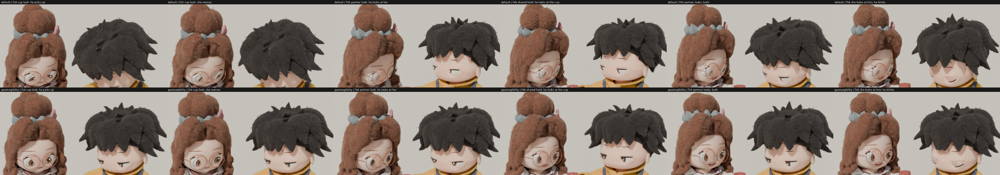

# T-120: gaze legibility

**With `"gazeLegibility"` on, the girl's pupils show through her lenses and the boy's glance shows under his fringe in
the exchange's shot camera, for the cup looks and the partner looks.** It is opt-in: without the key every pose is
identical to before. Input: [T-116 review §1–2](../../../audit/current_review/REVIEW.md), T-113 open point 3.



Top row: engine default. Bottom row: `gazeLegibility`. Same shot, cast (boy 2.1.0, girl 0.12.0), camera, frames,
640 × 360, Cycles 10 spp. The faces strip shows the same pixels enlarged 2×.
[Whole frames](t120_before_after_strip.jpg)

| frame | look | default | gazeLegibility |
|---|---|---|---|
| f18 | he looks at the cup (pickup) | his head is 33° down, the fringe covers both eyes | head 12° down, both pupils under the fringe |
| f24 | she notices the cup | no pupil in either lens (eyes 25° down, 30° sideways) | both irises inside the lenses |
| f36 | he looks at her | his eyes read, hers do not | both read |
| f48 | shared hold, he looks at the cup | his irises sit at the outer eye corners, hers are under the lower lids | both read |
| f54 | they look at each other | hers hidden, his at the eye corners | both read |
| f58 | she looks at him, he blinks | hers hidden | hers read (his blink is the shot's own) |

## What the flag does
Scene key (all characters) or character key (one character; its fields win), in `engine/scene/scene.h`:

```json
"gazeLegibility": {"rangeDeg": [16, 8]}
```

- **Eye clamp.** The eyes stay within `rangeDeg` [yaw, pitch] of the head in every frame: softly while aiming, and
  as a hard clamp after eye darts and gaze bias, so blinks are covered too. `rangeDeg` is the character's spec
  `face.eyes.gaze_range_deg` (16 / 8 for both current characters). The engine package does not carry it, so the
  shot writes it.
- **Eyes lead.** The eyes go to a new target at once. The head starts `leadFrames` later (default 3, at 24 fps) and
  eases over `turnFrames` (default 8).
- **Just enough head.** The head turns only by what the worse-placed eye lacks to reach the target inside its
  comfortable range, up to `headYawDeg` / `headPitchDeg`. These default to the character's `life.gaze`
  `assistYawDeg` / `assistPitchDeg`. A target the eyes reach alone moves no head. A hand-keyed neck is left alone.
- It replaces the life layer's head follow (`headFollow`) and the neck / chest assist for that character.

Measured on the two bakes ([gaze_angles.json](gaze_angles.json), [measure_gaze.py](measure_gaze.py)), largest eye
travel relative to the head over all 66 frames:

| | boy yaw / pitch | girl yaw / pitch |
|---|---|---|
| default | 30.6° / 25.0° | 30.0° / 25.0° |
| gazeLegibility | 16.0° / 8.0° | 16.0° / 8.0° |

## Eval shot
[`episodes/e911_gaze_check/`](../../../../episodes/e911_gaze_check/make_shot.py) writes two copies of the e907 s010
exchange (read only): `s010_default` (unchanged) and `s010_legible` (the scene key above, plus
`"gazeLegibility": {"headPitchDeg": 10}` on the boy). The boy needs the pitch cap: with his default 35° the head
follows the cup down and the fringe covers the glance again (I rendered f18 that way first). The girl already has
`assistPitchDeg` 10 in the shot.

```
python3 episodes/e911_gaze_check/make_shot.py
python3 pipeline/production/run_shot.py --shot episodes/e911_gaze_check/shots/s010_legible/shot.scene.json \
    --blender <bpy 5.3 wrapper> --frames 18-18 --samples 10      # also s010_default; frames 24, 36, 48, 54, 58
python3 docs/evaluation/animation/T-120/make_strip.py
python3 docs/evaluation/animation/T-120/measure_gaze.py
```

## For T-114 (e909) and T-117 (e910)
Set in the shot's scene, and on the boy:

```json
"gazeLegibility": {"rangeDeg": [16, 8]}
{"name": "boy", ..., "gazeLegibility": {"headPitchDeg": 10}}
```

Keep the girl's `life.gaze.assistPitchDeg` at 10, or give her the same `headPitchDeg`.

## Tests
`tests/test_gaze_legibility.cpp`, 5 cases: lead and turn timing (also at 48 fps), just-enough turn and caps, the
clamp, default-off identity plus the range through 72 blink frames on the imported girl, key parsing and round trip.
Full suite: 215 cases pass, the 210 existing ones unchanged.

## Open points
1. **The gaze no longer reaches a steep target.** With the head capped at 10° and the eyes at 8°, a cup 45° below
   eye level is looked *towards*, not *at*. This is the trade for visible pupils. Raising the cap brings back the
   hidden glance.
2. **Short glances and the head.** A look shorter than `leadFrames + turnFrames` (11 frames) ends before the head
   arrives, so the head still finishes its move after the eyes have left. In e911 the boy's f44–51 cup glance leaves
   his head 9° down at f56–58 while he looks up at her. The default gaze does the same with a larger angle (28°
   at f56). Shorter `turnFrames` or longer looks avoid it.
3. **The girl's partner look stops short.** Her eyes end at 16° and her head at the shot's 15° yaw cap, about 20°
   short of his face. It reads as a look at him in the frame.
4. **`rangeDeg` is written by the shot**, not read from the character. Carrying `gaze_range_deg` in the engine
   package needs the exporter, outside this write-set.
5. Not rendered: a whole movie, and the T-109 / T-113 / T-115 face candidates in this camera.
