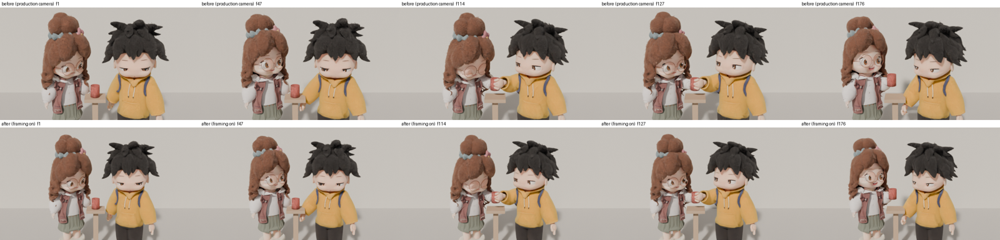

# T-140 (C1): director headroom and framing rules

Branch `t-140-claude-framing`, input `integration/t-133` @ 4be6e28.

## 1. Where the camera code is
- `engine/scene/actions.cpp`: `planShots()` is the automatic camera ("director"). It is opt-in through the scene key
  `"director"` (`Scene::director`, `engine/scene/scene.h`) and called at the end of `compileActionsBody()`.
- `engine/scene/scene.cpp` only parses and saves the key. T-140 does not touch `scene.cpp`, `scene.h` or the verb and
  interaction files.
- e907, e909 and e910 use no director: each has a static, hand-placed scene camera.

## 2. Framing report (production shots, unchanged)
Measured with `characterGlobals` and each character's skinned rest mesh. Every vertex is counted for its most
weighted joint:
- head = the head bone and its children (hair, the bun and its spring bone `DYN-bun.*`, the glasses);
- hands = `hand.L` / `hand.R` and the fingers;
- cup = the felt cup's cylinder.

Frame coordinates run -1 to 1. A part is **cropped** when it goes past ±1. It is **tight** when it is within 5% of the
frame height of an edge (|y| > 0.9).

| Shot | Cropped | Tight | Never cropped |
|---|---|---|---|
| e907 s010 (f1-66) | boy's left hand, below the frame, **f1-66** (lowest point -1.13) | girl's bun at the top, f1-52 and f59-66 (top 0.916) | the cup; the boy's head; the girl's hands |
| e909 s010 (f1-286) | boy's left hand, below the frame, **f1-286** (-1.13) | boy's right hand at the bottom, f50-110 and f238-286; girl's bun, f56-69, f142-146 and f235-240 (top 0.921) | the cup; both heads |
| e910 s010 (f1-192) | boy's left hand, below the frame, **f1-192** (-1.15) | boy's right hand at the bottom, f160-192; girl's bun, f1-34, f61-69, f73-127, f134-135 and f142-151 (top 0.925 at f127) | the cup (lowest point -0.61); both heads |

The hair and bun are never cut in these three shots, but the girl's bun sits 4% below the top edge, and nothing
guards it. The boy's left hand hangs at his hip below the frame in every frame of all three shots. The cup stays in
frame throughout.

## 3. The rules (opt-in)
Scene key: `"director": {"framing": true | {"headroom": 0.05, "safeMargin": 0.04, "reachCrop": "hands" | "face"}, "cuts": true | false}`.
`cuts` defaults to false when framing is on (only the refitted master camera) and to true when framing is off (the
cuts the director planned before T-140).
Without `framing`, or with `framing: false`, the director plans exactly as before (`tests/test_framing.cpp`). Golden
hashes and existing shots do not change: no production shot uses the director.

How it works:
- After a shot is planned, its camera keeps its direction, lens and push-in. It backs off (never pushes in further)
  and shifts its target until every required point stays inside the safe area at every frame of the shot.
- **Headroom.** The top of every framed head stays `headroom` (as a fraction of the frame height) below the top
  edge. The head is measured from the skinned geometry carried by the head bone and its children, so hair, a bun and
  accessories count. Each carrying bone contributes its extreme vertices along 124 directions.
- **Safe margins.** Every other required point stays `safeMargin` from each edge.
- **Crop choice for reach acting (`reachCrop`).**
  - `"hands"` (default): the medium reach shot keeps the reaching character's head, both hands and the object. Wide
    shots keep every head, every hand and every prop.
  - `"face"`: keeps only the heads and the object or props, so hands may leave the frame.
  - In both modes, close-ups keep the whole head and inserts keep only their subject.
- **`"cuts": false`** (the default with framing): only the master (wide) camera is kept, refitted. This gives a
  like-for-like before/after for shots with a hand-placed camera. `"cuts": true` adds the planned medium, insert and
  close-up shots, each refitted.
- **Limit.** The fit measures the kinematic pose, as all action planning does: `load()` builds secondary motion after
  the actions compile. The girl's spring-driven bun can therefore swing about 6 mm past the fit, about 1.3% of the
  frame height on e910. With `"face"` her top reaches 0.912 against the 0.90 line. That is still inside the frame.
  Moving the director after the dynamics build in `scene.cpp` (owned by T-136) would remove this gap.

## 4. Before / after on e910 (`docs/evaluation/animation/T-140/e910_framed/shot.scene.json`)
The experiment is the production e910 shot plus `"director": {"framing": true, "cuts": false}`. The production shot is
unchanged.

| | Camera | Girl's top (bun) | Boy's top | Boy's left hand, lowest | Cup | Cropped frames |
|---|---|---|---|---|---|---|
| before (production) | 32 mm, 1.49 m | 0.925 | 0.864 | **-1.149 (cropped f1-192)** | -0.61..-0.14 | 192 |
| after, `reachCrop: "hands"` | 32 mm, 1.70 m (+14%), target 4 cm lower | **0.883** | 0.828 | **-0.915** | -0.46..-0.04 | **0** |
| after, `reachCrop: "face"` | 32 mm, 1.49 m, target 5 mm higher | 0.912 (spring overshoot, §3) | 0.850 | -1.161 (cropped, allowed) | -0.63..-0.15 | 192 (hand only) |

e907 and e909 with `framing: true, cuts: false` give the same result: +13% distance, the bun at 0.876 and 0.882, the
left hand at -0.915, and no crops.

The strip shows f1, f47 (pick-up), f114 (contact), f127 (the bun at its highest) and f176 (look away), rendered at
480x270 with Cycles 8 spp. Top row: before; bottom row: after. In the after row the bun has clear headroom, the boy's
left hand and the cup stay in frame, and the faces still fill the frame.

**Face size after the +14% back-off.** Projected head height, hair included, as a fraction of the frame height. The
pixel counts are at the 640x360 delivery size.

| | Girl, mean (min) | Boy, mean (min) |
|---|---|---|
| before | 0.75 (0.74), about 271 px | 0.51 (0.48), about 183 px |
| after | 0.66 (0.65), about 239 px | 0.44 (0.42), about 159 px |

Each head shrinks by about 12% and still takes up 42-66% of the frame height. The eyes and glasses stay legible in the
strip. `readability.py` was not run: it needs mask renders of the whole shot.

## 5. Tests and checks
- `tests/test_framing.cpp` has three cases:
  - framing off or absent leaves the camera keys identical;
  - on a tight master, the head top goes from 2.18 (hair cut) to 0.897 (headroom line 0.90), and the reaching hand
    stays inside the safe area;
  - framing on, with `cuts` left at its default, gives one refitted master in the same direction, and `"face"` backs
    off no more than `"hands"`.
- **Framing off does nothing.**
  - Test 1 compares the camera keys with `framing` absent and with `framing: false`, key by key, and they are
    identical.
  - The code path is unchanged when framing is off: no measuring, no refit, and `cuts` stays true.
  - No production shot sets `director`.
  - `ctest` (fast-dev; the renderer tests are skipped because the renderer is not built) passes, including the golden
    bake hashes. No test, threshold or golden changed.
