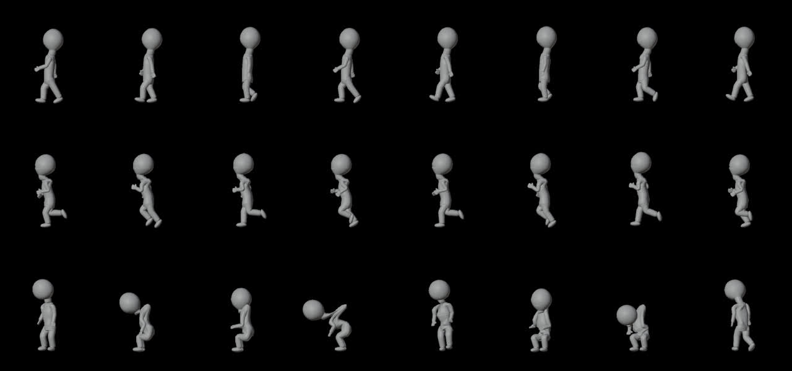

# T-174 · Animation: reuse vs build (research only)

Owner request 2026-11-20 ~22:55Z. Branch `t-174-claude-anim-reuse` from `origin/main@405da93`. No implementation and no
Codex. The only code is a throwaway feasibility script in [`test/`](test/).

## Answer in five lines
1. **Keep our engine.** The retarget math, layering, verbs, grasp, personality, timing and checks cover most of what the
   reference videos show: seated or standing acting, gaze, reach, point, hand work and reactions. No tool we could buy or
   download does these better for chibi plush figures.
2. **Reuse mocap only for whole-body motion**: walk, run, sit down, stand up, turns. We already have the importer math
   (ANIMATION_CLIPS §8, "future mocap conversion"). A headless test turned three CMU takes into `plush.clip/1` and played
   them on the chibi mannequin with **0.000° error on every arm and leg role** (section 4).
3. **Build only three small things**: a BVH → clip importer (proven here), a foot-lock pass (the `contacts` field already
   exists), and a chibi "style filter" (lean and stride scale) so adult mocap suits big heads.
4. **Skip** ML text-to-motion, video-to-mocap services, Cascadeur, motion matching, physics and paid retarget add-ons.
   Each fails on licence, determinism, headless fit or chibi fit, and saves us nothing we need now.
5. **Estimate:** whole-body locomotion and sitting through mocap reuse ≈ **3–4 task-days**. Hand-building them to the
   same quality ≈ **7–10 task-days**. Acting and interaction stay on the existing custom path, with no new system.

## 1. What we already have (keep)
| Area | What exists | Where | Effort already spent (from TASK_LOG / T-162) |
| --- | --- | --- | --- |
| Clip format + retarget | `plush.clip/1`; one retarget algorithm; boy vs girl ≤ 0.95°, engine vs Blender ≤ 0.047° | `engine/model/clip.*`, `pipeline/clips/` (T-002, T-008) | ~2 tasks; mocap path specified, not built |
| Clip library | 23 script-made clips: idle, wave, point, `sit_down`/`stand_up`, 10 emotions, shrug, yawn, 5 character gestures | `content/clips/` (T-002, T-003, T-027, T-097) | ~6 tasks |
| Procedural walk | footstep walk action: planted feet, lift, pelvis bob, yaw to target; used only in test/eval shots | `engine/scene/actions.cpp` "walk" | part of M3.2/T-001 |
| Interaction | affordances + verb expander (pick_up, carry, place, pass, react), 11 hand shapes, per-finger grasps, graspFit, band options, collision bodies, reach | `content/verbs`, `content/hand_shapes`, `engine/scene/verbs.*`, `interaction.*`, `collision.*` (T-047, T-051, T-111, T-112a/b/c, T-134, T-138, T-157) | ~10 tasks |
| Acting | personality profiles, reaction planner from scene events, emotion blending, calibrated timing (default), gaze legibility, face layer | `engine/anim/personality.*`, `engine/scene/reaction.*`, `content/timing`, `content/personality` (T-053, T-097A–D, T-104/d, T-120, T-046) | ~10 tasks |
| Reference data | 85 timed observations from the two reference videos | `docs/evaluation/animation/T-106/` | 1 Codex task |
| Checks | animcheck (principles, acting signature, gesture attribution); motion_checks (flicker, popping, interpenetration, reach) | `tools/animcheck`, `tools/motion_checks` (T-061, T-097C, T-125, T-135, T-139) | ~5 tasks |
| Shots | e905–e911, e909 two-character acting, e910 8 s cup exchange showcase | `episodes/` | ~6 tasks |
| Licences | ACCAD, CMU = ALLOW in repo; Mixamo, Rokoko = LOCAL-ONLY | `docs/references/MOCAP_LICENSES.md` (T-007) | 1 task |

About 42 TASK_LOG rows are animation, interaction or acting work. Measured implementer costs where recorded: T-117
$6.10, T-138 $6.05, T-136 $15.00, T-134 $23.53 (`docs/process/T-162/data.csv`). The custom stack is mature for the
reference content. Its gap is whole-body locomotion, which neither reference video shows.

**What the benchmark actually needs.** Both reference videos show characters at a table: they fold paper, place a boat,
point, lean in, react in wonder and hold gaze (VIDEO_BENCHMARKS.md, T-106). There is **no walking, running or
sitting down on screen**. Locomotion is therefore lower priority than acting and hand work, so the minimal-effort
choice for it is reuse, not invention.

## 2. External options compared
Ratings: ++ strong · + good · ○ neutral · − weak · −− blocker. "Det." = deterministic, headless and scriptable with bpy 5.3 + our engine.

| Option | Chibi fit | Quality vs refs | Det. / headless | Licence (commercial · repo) | Cost / effort | Lock-in | Verdict |
| --- | --- | --- | --- | --- | --- | --- | --- |
| **CMU mocap** (2,887 takes: 646 walk, 162 run, 57 sit, 14 stand-up, 26 pick-up, 118 two-person) | + after style filter | + locomotion; − acting (adult, generic) | ++ (BVH, tested here) | ✅ commercial · ✅ repo (attribution) | free; importer ~1 d | none | **REUSE (primary)** |
| **ACCAD Open Motion** | + | + locomotion, a few props/boxes | ++ (BVH) | ✅ CC BY 3.0 · ✅ repo | free; same importer | none | **REUSE (secondary)**. Host is blocked here |
| Mixamo | + (many cartoon-ish styles) | + locomotion, ○ acting | ○ (FBX; manual download, account) | ✅ videos · ❌ repo (LOCAL-ONLY) | free; account | Adobe account | Optional, owner-local only |
| Rokoko free library / Rokoko Vision | + | + | − (account login, cloud) | ✅ videos · ❌ repo; no ML use | free tier | account-bound licence | Skip |
| ActorCore (Reallusion) | + | ++ polished | ○ (FBX; purchase) | ✅ royalty-free use · ❌ redistribution; proprietary-format limits | paid per pack | vendor | Skip for now |
| Truebones | ○ | ○ | ○ | ✅ commercial · ❓ redistribution unclear | free/paid packs | — | Skip (unclear) |
| Bandai-Namco research set (stylised walks, emotions) | + (stylised) | + style variety | ++ (BVH on GitHub) | ❌ **CC BY-NC 4.0** (non-commercial) | free | — | Deny unless the project is non-commercial (Q1) |
| AMASS / HumanML3D | + | + | ○ (SMPL conversion) | ❌ non-commercial research only | free | — | Deny |
| Text-to-motion ML (MDM, MoMask, MotionGPT…) | − (SMPL adult bodies) | ○ generic, noisy | −− GPU, nondeterministic | ❌ trained on AMASS/HumanML3D (non-commercial) | high integration + GPU | model churn | Skip |
| Video-to-mocap (Move.ai, DeepMotion, Rokoko Vision) | ○ | ○ (needs a real performer; foot jitter) | − cloud, account | per service ToS | subscription | vendor | Skip; revisit only for bespoke acting |
| Cascadeur | + (physics-assisted keyframing) | + if an animator uses it | −− GUI tool, not scriptable | Free tier non-commercial; Indie < $100k/yr; FBX export paid | licence + animator time | tool | Skip (no animator in the loop) |
| Motion matching / learned locomotion | ○ | + for games | − needs a large clip DB + runtime | depends on data | weeks | high | Skip (film shots, not interactive) |
| Physics (MuJoCo, Apache-2.0) | − (plush balance tuning) | ○ | + | ✅ | weeks of tuning | medium | Skip |
| Blender retarget add-ons (Rokoko Retargeting, Expy Kit/"Retarget", Auto-Rig Pro) | + | n/a (tools) | ○ (GUI-oriented, rig-specific) | GPL tools ✅ (Rokoko needs login; ARP paid ~$40) | 0.5–1 d each to script | Blender-side rig dependence | Skip: our engine already retargets, deterministically, to all three characters |
| Rigify / NLA / action layers (Blender built-ins) | ++ (our rig is Rigify) | n/a | ++ | ✅ | already used | none | **KEEP**: authoring and mannequin only; the engine stays the animation authority (owner decision 2026-11-15) |

## 3. Keep / reuse / build matrix per motion category
| Category | KEEP (ours) | REUSE (external) | BUILD (custom, small) | Notes |
| --- | --- | --- | --- | --- |
| **Walking** | walk action as the root path, footstep planner and timing; personality tempo | 3–5 CMU/ACCAD walk cycles (neutral, slow, happy, tired) as clips | importer; foot-lock to the walk's planted steps; stride scale for short legs | test: limbs 0.000°, feet float 16–22 mm (≈7–9 % leg) and slide → foot-lock needed |
| **Running** | as walking | 1–2 CMU run cycles | as walking | test: limbs 0.000°, slide 11–30 mm per plant |
| **Sitting / standing up** | `sit_down`/`stand_up` seat contact (`height_ratio`), base idle | CMU 13_xx/14_xx stool takes (≥ 14 sit-and-stand) | chibi lean scale (big head moves a lot: f4 of the strip); seat-height retime | keep the script clips as a fallback; the mocap version is nicer weight shift |
| **Character reactions** | personality, reaction planner, emotion clips, blending, gaze, face layer, T-106 timing | — (mocap acting is adult, theatrical, off-model) | nothing new; tune clips only when a shot needs it | refs are subtle plush acting: custom wins |
| **Interacting with objects** | affordances, verbs, hand shapes, grasps, graspFit, collision, reach | optional CMU "pick up / reach" for body weight shift only | nothing new now; T-171 hands round 2 continues as planned | mocap has no usable finger data; the verbs already place hands exactly on props |
| **Character ↔ character** | pass verb, e909/e910 staging, gaze legibility, collision bodies | CMU two-subject takes are only useful as timing reference | nothing new | exact hand-offs need our verbs; mocap pairs do not retarget to different-size chibis without contact solving |

## 4. Feasibility test (headless, done)
[`test/bvh_retarget_test.py`](test/bvh_retarget_test.py) runs on Blender 5.3 `-b --factory-startup`. It reuses the
existing `retarget.py` and `clip_tools.py` (about 150 new lines, no pipeline change):
1. imports a CMU BVH (cgspeed 2010 release; frame 1 is a T-pose, used as the source rest);
2. maps 11 roles plus mirrors and writes `plush.clip/1` (dense, 120 → 24 fps, `source: mocap`, CMU licence and
   attribution);
3. plays the clip on the neutral chibi mannequin (`build_mannequin.py`, leg 0.248 m vs source ≈ 14–15 units) and
   measures it.

| Take | Frames @24 | Arm/leg/spine dir error | Hips / neck dir error | Ankle above rest (min) | Longest slide while planted |
| --- | ---: | --- | --- | --- | --- |
| 07_01 walk | 64 | 0.000° | 11.0° / 7.7° | 22 / 16 mm | 157 / 13 mm |
| 09_01 run | 30 | 0.000° | 18.1° / 17.2° | 11 / 11 mm | 30 / 11 mm |
| 14_31 sit, stand | 419 | 0.000° | 49.8° / 10.6° | −1 / −3 mm | 104 / 61 mm |

Rows from top: walk, run, sit/stand. The Workbench side view is evidence for this test only; it is not a quality sheet.
- **Limb chains transfer exactly.** The retarget cancels the proportions, as section 8 predicts.
- **Hips and neck errors are a mapping detail.** CMU has extra joints (LowerBack, Neck1) that we don't map. The fix is
  to fold them into hips and neck in the importer (≈ 0.25 d).
- **The feet need a foot-lock pass.** Chibi thigh, shin and foot ratios differ from an adult's, so planted feet float or
  slide. This is the known limit in ANIMATION_CLIPS §9: `contacts` are recorded but not yet used. The slide numbers
  come from a crude height-threshold detector and are upper bounds.
- **Chibi style.** Walk and run read well and look plush-appropriate in silhouette. In sit/stand, the adult's deep
  forward lean throws the big head to knee height. A lean scale on spine and chest (for example ×0.5–0.6) is needed.
- **Preview-only artefact.** On the mannequin, the shoulder and pelvis deform bones are top-level, so root motion was
  put on the object for the preview. This matches how the engine moves the whole character.
- **Not tested:** engine playback of the generated clip. The C++ build was not run, and the math is identical (doc
  §4: ≤ 0.047°). Also not tested: the real boy, girl and third packages.
- **Hosts:** the test used `raw.githubusercontent.com` (the `una-dinosauria/cmu-mocap` mirror of the CMU BVH conversion,
  which CMU and the converter allow to be redistributed). **Blocked here, not requested:** `mocap.cs.cmu.edu`,
  `accad.osu.edu`, `www.mixamo.com`, `amass.is.tue.mpg.de`, `huggingface.co`, `extensions.blender.org`,
  `www.rokoko.com`. ACCAD would need `accad.osu.edu` (and its download host). Neither the BVH nor the clips are
  committed; only the numbers and the strip are.

## 5. Recommended approach (one)
**"Engine stays, mocap feeds whole-body clips."** In order, each step opt-in with goldens unchanged:
1. **T-a Importer** (≈ 1 d, Opus): `pipeline/clips/import_bvh.py` from this test. Adds the CMU (and ACCAD) role maps,
   folds the extra spine and neck joints, resamples to 24 fps, writes licence and attribution, and auto-fills
   `contacts.foot_plant` from source foot height and speed. Tests: round-trip on `dense_test`, 0° limb error.
2. **T-b Starter set** (≈ 0.5 d): about 8 clips from CMU only. Walk (neutral, slow, happy), run, turn in place,
   sit-on-stool, stand-up, idle shift. Stored in `content/clips/mocap/` with attribution (CMU = ALLOW in repo).
3. **T-c Chibi style filter + foot-lock** (≈ 1.5–2 d): per-clip `style` block (spine/chest lean scale, stride/root
   scale by leg ratio, arm swing scale) read by `clip_layers`; a two-bone leg IK pin on `foot_plant` frames. Accept on
   motion_checks (foot slide ≤ 3 mm, no popping) and one strict sheet per character.
4. **Walk action uses clips** (≈ 0.5 d, can merge with T-c): the existing walk keeps the path, plants and timing. The
   legs and torso come from the selected cycle, phase-matched to the steps.

**Total ≈ 3.5–4 task-days**, roughly $25–40 of implementer cost (E), based on recorded engine tasks at ≈ $6 each
(T-138, T-117) and up to $15–24 for tasks with visual review rounds (T-136, T-134).

**Continuing custom** for the same set means procedural run, upgraded walk, turns, sit/stand weight shifts and a
style pass. Estimate ≈ 7–10 task-days plus more review rounds, because hand-made locomotion usually needs several
"feels robotic" iterations. Acting, reactions, object and pair interaction: **no change**. Continue with T-171 and the
existing verbs. That is where the reference videos are, and where no external solution fits.

**Simplifications that cut time and tokens:**
- Don't build new authoring tools, add-ons or ML.
- Don't start locomotion until a shot needs it. The benchmark shots don't.
- Use the existing motion_checks and animcheck as acceptance, not new sheet scripts. Use one strict sheet per
  character only at the end.
- Pick clips from the CMU text index with a short list. Don't browse the full library.

## 6. Risks
- **Style mismatch.** CMU is adult, realistic and sometimes noisy. Even filtered, it may read "human" rather than
  "plush". Mitigation: the style filter, plus personality timing on top; reject takes that don't fit.
- **Foot contact.** Without foot-lock, mocap slides on chibi legs (measured). Foot-lock is the one genuinely new engine
  feature. It also sits under the T-047 collision rules and must keep the default bakes byte-identical.
- **Rigid shoulders and hips** in the Rigify packages (§9). Large mocap torso motion can open gaps at the shoulders
  and pelvis. Large leans make this worse, which is another reason to scale them down.
- **Licence drift.** Keep repo clips to CMU and ACCAD. Mixamo and Rokoko remain LOCAL-ONLY. The CMU attribution must
  ship with clips and with published credits.
- **Unverified on real characters.** The test used the mannequin. The released 2.3.0/0.14.0/0.1.0 packages have
  garments and hair (secondary motion on fast runs is unmeasured).
- **Scope creep.** Mocap invites "just one more clip". Limit it to clips a planned shot uses.

## 7. Owner questions
1. **Commercial or not?** Is Plush Studio output meant to be commercial (monetised videos or sales)? If it's strictly
   non-commercial, the stylised Bandai-Namco set (CC BY-NC) becomes usable, though it's still not ideal for the repo.
2. **Is locomotion needed now?** Neither reference video shows walking, running or sitting down. Start T-a–T-c now,
   or only when a planned shot needs a character to enter, walk or sit?
3. **Mixamo locally?** Allow Mixamo for owner-local renders only (never in the repo)? It's a larger cartoon-friendly
   library, but you would need an Adobe account and manual downloads.
4. **Hosts.** Allow `mocap.cs.cmu.edu` and `accad.osu.edu`, for the official sources and ACCAD? CMU already works through
   the GitHub mirror, so this is optional.
5. **Style bar.** Is "realistic adult motion, toned down" acceptable for plush characters, or should locomotion be bouncier
   and more cartoon-like? The second would mean more custom keyframing, about +2–3 d.

## Sources (licences checked 2026-11-20)
- In-repo: `docs/references/MOCAP_LICENSES.md` (T-007: CMU, ACCAD, Mixamo, Rokoko, with quoted terms).
- CMU via the cgspeed conversion `READMEFIRST.txt` ("free for use in research and commercial projects worldwide"), mirror
  https://github.com/una-dinosauria/cmu-mocap
- Bandai-Namco: https://github.com/BandaiNamcoResearchInc/Bandai-Namco-Research-Motiondataset (README: CC BY-NC 4.0)
- AMASS licence: https://amass.is.tue.mpg.de/license.html (non-commercial; no training for commercial use)
- Cascadeur: https://cascadeur.com/plans, https://cascadeur.com/education (free = non-commercial; Indie < $100k/yr)
- Reallusion content EULA: https://www.reallusion.com/Content/EULA/EULA.htm
- Truebones terms: https://truebones.gumroad.com (royalty-free use; redistribution not confirmed)
- Blender "Retarget" (Expy Kit fork, GPL-3.0+): https://extensions.blender.org/add-ons/retarget/
- Rokoko Blender retargeting: https://support.rokoko.com/hc/en-us/articles/4410463481489 (free; account login reported)
