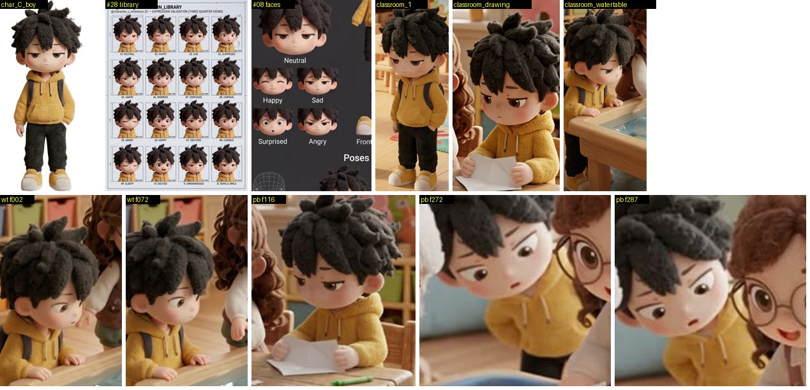
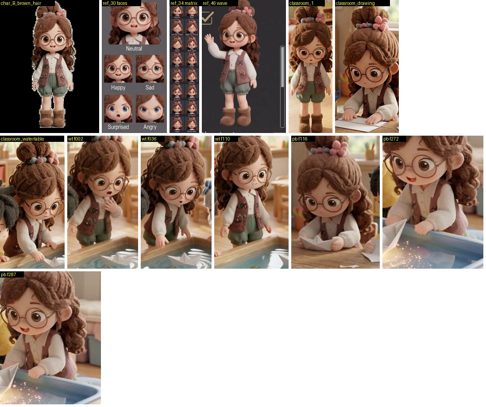

# T-053a report: reference behaviour and expression analysis (2026-11-17)

Study only; no code, spec, engine or tool changes. Objective: derive each character's behaviour and expressions from
the owner references (primary target, owner decision 2026-11-17) and record draft personality profiles.

## Deliverables
| Item | File |
| --- | --- |
| Inventory + citation keys + reference conflicts | [docs/characters/REFERENCE_INVENTORY.md](../../../characters/REFERENCE_INVENTORY.md) |
| Boy reference guide | [docs/characters/boy_yellow_hoodie/REFERENCE_BEHAVIOUR.md](../../../characters/boy_yellow_hoodie/REFERENCE_BEHAVIOUR.md) |
| Girl reference guide | [docs/characters/girl_auburn_bun_glasses/REFERENCE_BEHAVIOUR.md](../../../characters/girl_auburn_bun_glasses/REFERENCE_BEHAVIOUR.md) |
| Profile schema (draft) | [content/personality/SCHEMA.md](../../../../content/personality/SCHEMA.md) |
| Draft profiles | `content/personality/boy_yellow_hoodie.draft.json` (49 cited values), `content/personality/girl_auburn_bun_glasses.draft.json` (47 cited values) |
| Review checklist | [docs/characters/REVIEW_CHECKLIST.md](../../../characters/REVIEW_CHECKLIST.md) |

## Contact sheets
Boy (identity still, `#28` library, `#08` faces, three classroom stills, video frames WT f002/f072, PB f116/f272/f287):

Girl (`char_B`, `ref_30` faces, `ref_34` matrix, `ref_46` wave, three classroom stills, WT f002/f036/f110,
PB f116/f272/f287):

## Extracted evidence (57 JPEGs total, limit 120)
- `frames/wt_2fps_01..10.jpg`, `frames/pb_2fps_01..24.jpg`: 2 fps overview of both videos (file n ≈ frame (n−1)×12).
- `key/`: full-resolution-ish key moments: `wt002`, `wt036`, `wt072`, `wt110`; `pb004`, `pb028`, `pb116`, `pb146`,
  `pb242`, `pb258`, `pb272`, `pb287`; hands `pb_hands050/062/098` (S2 folding) and `pb_hands163/181` (S4 placing).
- `strips/`: per-frame measurement strips: `wt_girl_eyes_f000-120` and `wt_girl_eyes_f020-080` (blinks),
  `wt_boy_eyes_f000-120` (blinks), `wt_girl_reach_f004-060` (every 2nd frame: chin → point timing),
  `pb_boy_face_s1_s3` and `pb_boy_face_s6` (every 3rd frame).

Method: ffmpeg scene detection for cuts (PB cuts at f32, f112, f151, f191, f239); 2 fps overview, then every
frame / every 2nd / every 3rd frame on face and hand crops around key moments. All frames were inspected visually;
counts are ±1 f where noted (boy's eyes partly hidden by the fringe).

## Main findings
1. **The references already encode the briefs, but subtly.** Boy: heavy upper lid at mid-iris as his default
   (even in T-pose), low flat brows, small pout, slouch, hands in pockets, long unchanging stares at the task; no
   smile in any scene reference. Girl: fully open eyes, high brows, closed soft smile at rest and frequent open
   smile, upright posture, thinking gesture (hand to chin), explaining by pointing, careful two-handed handwork.
2. **Measured timing** (WT, 24 fps): girl blinks 4× in 5 s (3–5 f, one 7 f during a gaze drop; two blinks fall on
   action changes); girl chin → point reach ≈ 8–10 f; point held ≥ 38 f while talking; boat placement ≈ 24 f
   lowering + 12 f release. Boy blinks 3× in 5 s (4–6 f) in WT but none visible in 71 f of PB S1/S3.
3. **Boy engagement looks like concentration, not joy**: at the sparkle reveal (PB S6) his eyes open and his brows
   pull down; the girl reacts with an open smile.
4. **Neither character ever looks at the other** in any reference; attention is always on the object.
5. **Reference conflicts** (inventory §"Known conflicts"): blue irises on three `ref_30` girl face tiles; open vs
   closed neutral mouth; misspelt/duplicated labels on `#28`.

## Points for the Supervisor
- **Roadmap vs references (boy):** ROADMAP "Priority v5" lists for the boy "restless weight shifts, foot tapping,
  sighs, looking away, quick abrupt moves, eye rolls". None of these is shown; the references show a **low-energy,
  slow, heavy-lidded** boy. Weight shifts, tapping, sighs and looking away fit as small extrapolations (they are in
  the draft as `kind: extrapolation`); **"quick abrupt moves"** risks contradicting the references' calm, slouched
  tempo, so the draft keeps his action speed at 1.0 and suggests short anticipation only. Recommend the owner
  confirms how visible his impatience should be.
- **Roadmap vs references (girl):** "upright open posture, frequent smiles, focused gaze, finger to chin, head tilt"
  are all supported; "light bouncy timing" is only weakly supported (walk cycles on technical sheets, brisk reach).
- Blink rates are high (≈ 36–48/min) in the 5 s video; real children blink less. T-053 should treat these as
  in-scene ranges, not as a long-shot average, and keep the long gaps seen in PB S1/S3 (boy).
- The face library has no "heavy lid" action unit; the boy's rest relies on a partial `Blink` (≈ 0.45). T-046/T-051
  should confirm a partial blink keeps the lid shape of `char_C` (flat lid line) rather than a half-closed dome.

## Not done / limits
- No renders and no code (out of scope). No numbers were taken from sheet annotations (unreliable per the indices).
- Weights in the expression tables are visual estimates; sub-frame timing is limited to 24 fps sampling of
  AI-generated video.
- The white-haired girl was deliberately not analysed.
