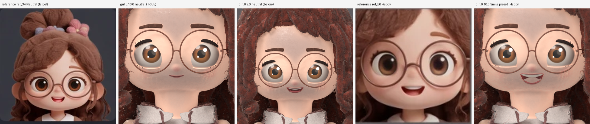
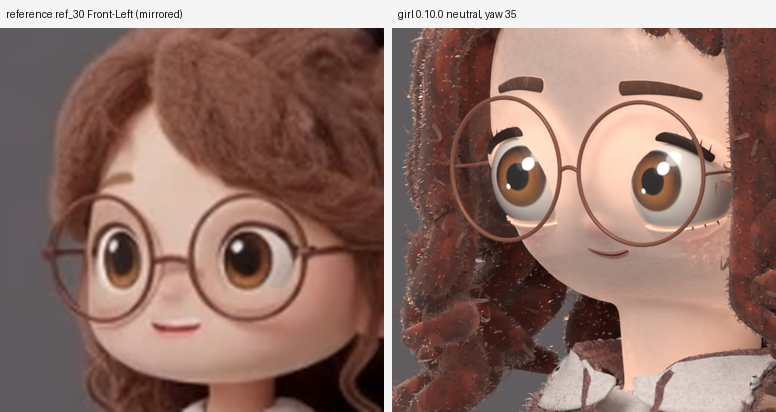
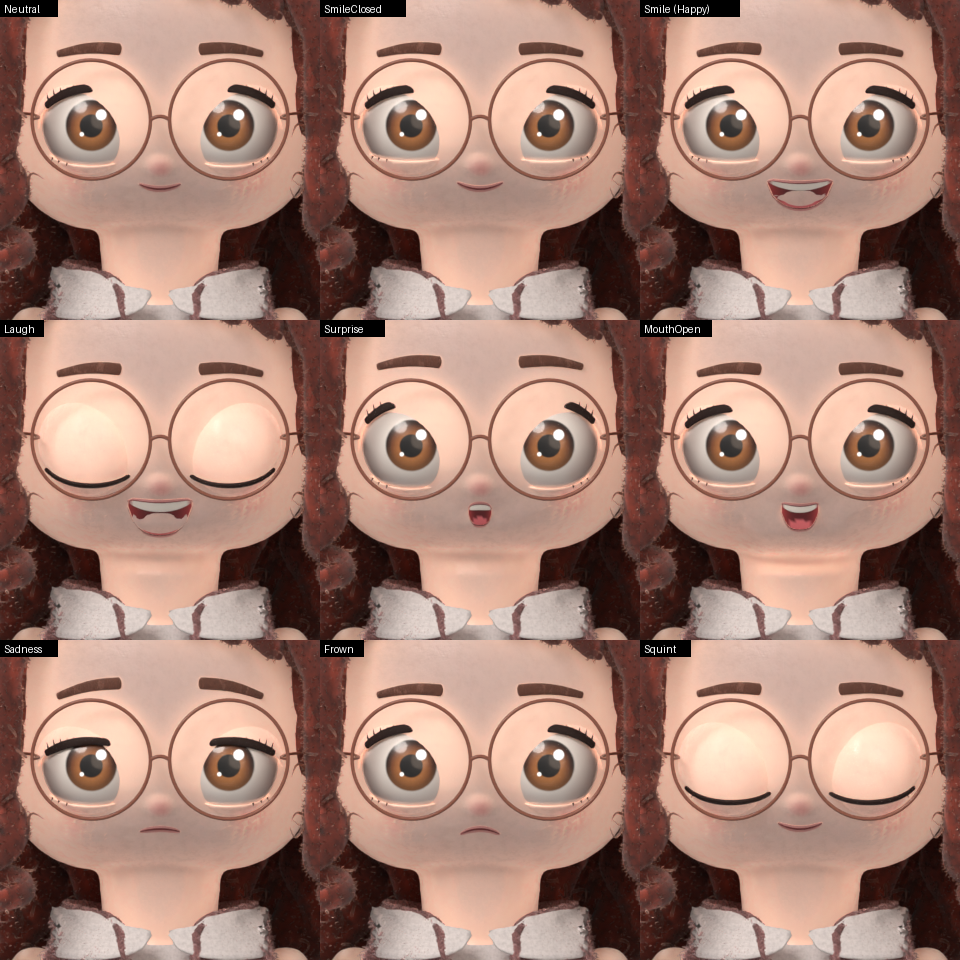

# T-055: girl 0.10.0 — closed gentle-smile neutral mouth

Owner decision 2026-11-17 (`docs/process/OWNER_DECISIONS.md`, "character details from the reference conflicts" §3):
the girl's neutral mouth is closed with a gentle smile; the open smile belongs to Happy. Eyes stay brown.
Path B: **awaiting owner visual approval**. Nothing is published or promoted.

## What changed

New spec version **0.10.0** as an override on top of the frozen 0.9.0 spec (same pattern as the boy's 1.1.0):
`assets/characters/girl_auburn_bun_glasses/spec/girl_auburn_bun_glasses.0.10.0.override.json`.
Build: `build_character.py --spec .../girl_auburn_bun_glasses.spec.json --override .../girl_auburn_bun_glasses.0.10.0.override.json`.

| Key | 0.9.0 | 0.10.0 |
| --- | --- | --- |
| `face.mouth.rest_shape` | `open_smile` (MouthWide 0.7 + MouthSmile 0.55 baked into the basis) | `closed_smile` (lips_jaw/2 neutral, nothing baked) |
| `face.mouth.frown_m` | −0.0022 (corners up 2.2 mm) | −0.0042 (corners up 4.2 mm: the gentle upturn) |
| `face.mouth.note`, `identity.approved_decisions.neutral_expression`, `metadata` | open-smile neutral | closed gentle smile, owner decision; `spec_version` 0.10.0, history line |
| `generators` | absent (defaults) | explicit pins, equal to the 0.9.0 defaults (body_generic/1, face_generic/1, groom/1, garment/1, accessories/1, rigify_human/1, presets/1, export/4) — build report: `defaulted: []` |

Everything else is identical to 0.9.0 (eyes brown `face.eyes.iris`, hair, outfit, body). `0.9.0`'s spec file is
untouched. `face.mouth.rest_mix` is still inherited from 0.9.0 but has no effect with `closed_smile` (the bake is skipped).
No generator code changed: the mouth generator already supports a closed rest from spec values.

Why `frown_m` and not a baked `MouthSmile`: `Smile`, `MouthFrown`, `MouthWide` and `MouthO` targets in lips_jaw/2 are
absolute, so changing `frown_m` moves only the rest pose; every expression still reaches the same full-weight shape.
Baking a partial `MouthSmile` into the rest would also weaken Frown/Sadness and could only be spelled as
`rest_shape: "open_smile"` with a closed mix (misleading label) — see limitations.

## Evidence (bpy 5.3.0 module, Cycles CPU + OIDN, shared calibration `character_neutral/1`)

Renders (`pipeline/charsys/tests/face_expression_sheet.py`, orthographic, framed on the face landmarks): 4 stills —
1 discarded first attempt (frown_m −0.0022, read as a flat line), front 512 px/24 spp, 3/4 512 px/24 spp, expression
sheet 9×320 px/16 spp. Compositions: `make_comparison.py`.

- `girl_0.10.0_face_front_vs_reference.png`: ref_34 Neutral | **0.10.0 neutral** | 0.9.0 neutral (consolidation
  close-up, different framing) | ref_30 Happy | 0.10.0 Smile preset (Happy).
- `girl_0.10.0_face_34_vs_reference.png`: ref_30 Front-Left (mirrored to match) | 0.10.0 neutral at yaw 35°.
- `girl_0.10.0_expression_sheet.png`: Neutral, SmileClosed, Smile (Happy), Laugh, Surprise, MouthOpen, Sadness, Frown, Squint.

Geometric check of the rest pose (no render, 0.10.0 master): lip seam gap **0.0 mm** (closed), corner lift
**4.2 mm**; the cavity (teeth/tongue layers) sits behind the closed seam, so no teeth or tongue at rest — the renders confirm.

## What I see (against the references)

- **Neutral:** closed lips, soft upturned corners, no teeth/tongue — matches the owner decision and the guide's
  "closed soft smile" (`REFERENCE_BEHAVIOUR.md` §1/§2). Eyes brown, brows/eyes unchanged.
- **Happy/talking:** Smile, Laugh, Surprise and MouthOpen open the mouth with upper teeth, tongue and red interior;
  open shapes appear only there. Sadness and Frown are now clean frowns (in 0.9.0 they sat on top of the open rest).
- **Deviations:** (1) ref_34 Neutral's mouth is wider with fuller pink lips and the cheeks visibly lifted; ours is
  narrower/thinner and the cheeks are not raised at rest (cheek lift comes only from `MouthSmile`'s smile coupling).
  (2) The Smile (Happy) preset's open smile is smaller and shallower than ref_30 Happy (unchanged library preset;
  in 0.9.0 it looked bigger because it added to the open rest). (3) Hair/head shape gaps from 0.9.0 remain (out of scope).

## Expressions vs 0.9.0

All presets keep their library weights; they differ from 0.9.0 only because the baked open rest is gone (the rest pose
is the only spec change). Full-weight shapes of Smile/Frown/Wide/O are identical targets; JawOpen corners follow the
new base `frown_m`.

## Limitations / questions for the Supervisor

1. **Cheeks raised at rest** (acceptance 1) is only partly met: `closed_smile` bakes nothing, and `rest_mix` is ignored
   for it. A spec-only alternative is `rest_shape: "open_smile"` + `rest_mix: {"MouthSmile": 0.25–0.4}` (closed lips,
   cheeks up), but the label would be wrong and every expression would carry the extra smile (weaker Frown/Sadness).
   Clean fix = generator change (new face version): let `closed_smile` honour `rest_mix`, or add a `soft_smile` rest shape.
2. Mouth width/lip fullness vs ref_34 could be tuned (`half_width_m`, `lip_height_m`), but `half_width_m` scales every
   mouth shape (expressions would change), so it was left for an owner decision.
3. Happy open smile size vs ref_30 (library preset or per-character `expressions.scale`) — separate task.
4. No new asset-version folder was created: publishing into `versions/` is an owner step.

## Tests

See the final report / gate summary below.
