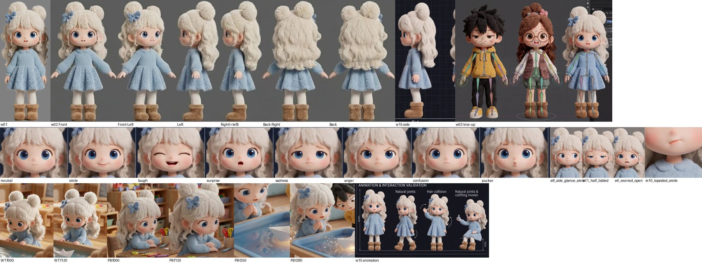

# T-057 report: third character reference intake, behaviour and gap analysis (2026-11-17)

Study + reference data only: no specs, generators, engine or tools changed; nothing built or rendered.
Character id: `girl_white_hair_blue_dress` (white felt hair with two pom-pom buns, blue knit dress, blue bow).

## Deliverables
| Item | File |
| --- | --- |
| Reference index (15 uploads with SHA-256 and roles, 86 views/tiles with crop boxes, yaw, priority rules, missing data) | `assets/characters/girl_white_hair_blue_dress/references/reference_index.json` |
| Crops (86 JPEGs, 2.1 MB) | `assets/characters/girl_white_hair_blue_dress/references/views/` |
| Face and body landmarks (front `w01`, side `w15`, line-up `w03`) | `.../references/landmarks.json` |
| Proportions, head-to-body ratio, face ratios, relative scale | `.../references/measurements.json` |
| Colour targets (hair, skin, cheeks, iris, sclera, dress, collar, cuffs, tights, boots, bow + `w10` swatches), with coordinates | `.../references/color_targets.json` |
| Behaviour guide + reference conflicts (§8) | [REFERENCE_BEHAVIOUR.md](../../../characters/girl_white_hair_blue_dress/REFERENCE_BEHAVIOUR.md) |
| Gap analysis vs the shared systems + priorities for hair v3 and garments | [SYSTEM_GAPS.md](../../../characters/girl_white_hair_blue_dress/SYSTEM_GAPS.md) |
| Draft personality profile (`plush.personality/0`, 61 cited records) | `content/personality/girl_white_hair_blue_dress.draft.json` |

## Contact sheet
Row 1: `w01` identity, `w02` turnaround (6), `w15` side, `w03` line-up. Row 2: `w04` Neutral, Smile, Laugh,
Surprise, Sadness, Anger, Confusion, Pucker; `w14` side glance, half-lidded, worried, lopsided smile.
Row 3: video key frames WT f000/f120, PB f000/f120/f250/f280, `w15` animation tiles.

## Video evidence (her only)
- `strips/wt_her_blinks_f015-f114.jpg`: every frame f015–f026, f052–f063, f103–f114 (3 blinks).
- `strips/wt_her_faces.jpg`: WT f000, f008, f016, f030, f044, f070, f078, f086, f096, f120 (parted vs closed lips).
- `strips/wt_her_body_every6.jpg`: WT every 6th frame (posture on the rim).
- `strips/pb_her_blinks_s1_s3.jpg`: PB f000–f015 and f118–f133, every frame.
- `strips/pb_her_hand_s2_f032-f110.jpg`: PB S2 every 6th frame (her blue sleeve holding the paper).
- `strips/pb_her_s6_f239-f288.jpg` (every 3rd) and `strips/pb_her_s6_blink_f240-f251.jpg` (every frame).
- `key/`: WT f000/f060/f120, PB f000/f120/f250/f280 crops.
Frame numbers are 0-based at 24 fps (same convention as T-053a). 15 JPEGs in this folder, 0.9 MB.

## Main findings
1. **Identity is consistent** across all 15 sheets and both videos except the hair accessory (bow in 10 sheets and
   both videos, a 4-petal flower in `w05`–`w08`) and two construction-sheet surfaces (plain skirt and smooth boots in
   `w09`). Iris colour is blue everywhere. Three uploads are byte-identical to existing references (`w01` =
   `char_A_white_hair`, `w03` = girl `ref_32` = boy `#10`, `w06` = girl `ref_37`).
2. **Scale** (`w03`, same floor line): she is 955 px vs the girl 983 px and the boy 976 px (sole to top), i.e.
   0.972× the girl (≈ 1.07 m if the girl is 1.10 m); eye line 0.717 of her height from the feet (girl 0.714).
3. **Proportions** (`w01` alpha silhouette): 2.66 heads incl. buns (2.99 excl.); eye line 0.282, chin 0.376,
   waist seam 0.533, hem 0.735, boot top 0.859 of the height from the bun top; `w15` side agrees within 0.011.
   Her eyes are larger and wider set than the girl's (eye spacing / ear width 0.42 vs 0.365).
4. **Behaviour in the videos**: she is the onlooker — leans on the rim (WT), sits with folded hands watching the
   girl's paper (PB S1/S3), rests a flat hand on the sheet while the girl folds (PB S2), clasps her hands under the
   chin with an "ooh" at the sparkle (PB S6). Lips hang slightly parted while she watches. Blinks: 6 measured,
   3–6 f long, 1–3 f closed, WT intervals 37 and 50 f; two of them sit on an expression change.
5. **Personality**: "bubbly, cheerful" is well supported (smiles in most stills, laugh tiles, clasped-hands delight).
   "A little goofy, not very bright" is only **implied**: wide-eyed open-mouthed watching, the follower role and
   comic tiles on the face sheets (side glance, half lids, pucker, lopsided mouths). No reference shows a mistake,
   a double-take or big comic motion; those are marked EXTRAPOLATION in the guide and the profile.
6. **Shared systems**: almost everything is spec-only; real gaps are a full gathered/pleated skirt, a cable-knit
   material, sided mouth corners + pucker, 3-bone bun chains and (optionally) tights and a scalp flower
   (SYSTEM_GAPS.md §2 has the prioritised list for hair v3 and garments).

## Points for the Supervisor / owner
- **Decisions needed** (listed, not resolved): bow or flower (§8.1); neutral mouth open or closed (§8.2); how
  visible the "goofy, not very bright" extrapolations should be (her references move very little — same question
  as the boy's impatience in T-053a).
- `docs/characters/REFERENCE_INVENTORY.md` (outside this task's write-set) still says the white-haired girl is
  "not analysed"; a one-line pointer to this guide would help.
- The draft profile adds three optional fields not in `content/personality/SCHEMA.md`: `attention.watches_others_work`,
  `gaze.spacey_drift`, `face.watching_mouth` (readers ignore unknown fields; schema update belongs to T-053).
- Measurement precision: landmarks ±2–5 px; line-up heights ±4 px in a perspective viewport (≈ ±1 % relative scale);
  video mouth timing ±2 f (small face), blink timing ±1 f.
