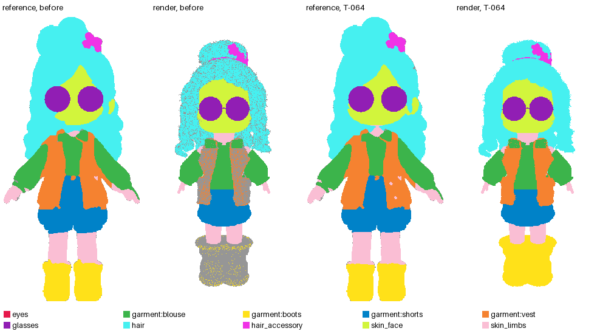
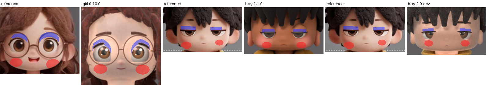

# T-064: fidelity tool fixes, so that measurements reward real visual improvements

Branch `t-064-claude-fidelity-fixes` from `origin/staging`. Date 2026-11-17. Blender: bpy 5.3.0 module (Linux, CPU,
Cycles + OIDN), driven through `tools/bpy_blender.py`.

> **Owner decision (binding).** Visual fidelity to the original references takes priority over numerical scores. The
> score supports the owner's side-by-side judgement and never overrides it. This report says plainly where the fixed
> score still disagrees with that judgement (§4).

## 1. Summary

Each item below is a defect found in the T-063 cases, its root cause, and the fix. Before the fixes, the tool
penalised real improvements.

| # | Problem (T-063 §5.2) | Root cause found | Fix |
|---|---|---|---|
| 1 | Girl boots IoU 0.07 (render 509 px vs ref 5235), vest area ×0.29 | The surface-fibre curves get their material from a geometry-node **modifier input**. The flat region pass swapped only material slots, so the fibres rendered black and were never classified: **26 % of the girl's figure** had no region. | `blender_render_side.py` swaps the node material inputs too. Any pixel still unclassified takes the region of its nearest neighbour (≤ 6 px), and the fraction is reported. Boots IoU 0.07 → **0.62**, vest 0.16 → **0.48**, hair 0.57 → **0.70**, unclassified 26 % → 0 %. |
| 2 | Girl hair IoU low; skin colour sampled from a sliver | Reference polygons are traced with their holes filled. The girl's front **hair outline also covered her face** (96 % of `skin_face`). The colour seeds also labelled her shaded right cheek and the skin around her right eye as hair. | (a) The analysis removes islands that lie on top of a larger region; `skin_face` keeps the eyes. (b) The `sheet30_front` annotation was regenerated with 2 added skin seeds (data only). The rest of the old annotation reproduces byte-identically from the old hints. |
| 3 | A fuller or flatter hair scored lower **everywhere** | The figure height (sole to top, hair included) set the scale for the **whole body**. Hair volume therefore misaligned the silhouette, landmarks and proportions. | The scale is now the median of body-landmark heights above the sole (chin, eyes, mouth, nose, neck, shoulders). Proportions use the same hair-free unit height. |
| 4 | T-049 C (judged best) scored 8 points below the baseline | Besides 3: T-049 rendered its study builds in the **A-pose**, while the baseline uses the arms-lowered compare pose that matches the references. `run.py` fell back silently because the study files are not named `*_master.blend`. | The fallback now writes a warning into the build record and `report.md`. For validation, the current hair was rendered on the same A-pose build (§3). |
| 5 | Hair score did not track the hair read | The only hair evidence was the region IoU. | New **hair part**: shape, volume, outline (rope and stringy raggedness), strand (directional ropes, rows and grooves), relief (fused helmet) and face cover. |
| 6 | Girl `skin_face` ΔE00 3.5 hid a visible grey cast | A median colour cannot see shading. The references keep warm chroma in shade and have strong blush. | New **skin part**: luma-matched ΔE00, \|ΔL*\| (wide tolerance), **chroma in shade** and **a\* P90 (blush)**. `skin_face` is used only in views where the face is seen. |
| 7 | Lid domes and weak blush were not measured | — | New **face windows**: lid band above the visible eye opening and a cheek window, in frontal views. They report `lid_dL`, `lid_dC` and `blush_da` relative to the face skin. |
| 8 | Proportion artefacts | In 3/4 views the legs overlap, so the reference gap was 0.4 % of the height, and the render's gap read as **+4700 %**. Holes between hair ringlets read as the crotch. | The leg gap is compared only where the reference gap is at least 5 %, hair holes are skipped, and no single proportion counts more than 100 %. |

Score weights changed from 6 to 9 parts; see `docs/CHARACTER_FIDELITY.md` § Metrics. The 2.0-point drop rule is
unchanged (`MAX_SCORE_DROP`, `policy` and `test_ci.py` are untouched).

Per-view region masks are now saved with every run (`masks/<view>.png`: reference | render | disagreement). Example:
[girl front](girl/masks/sheet30_front.png). Before and after the segmentation fixes:
[segmentation_before_after.png](segmentation_before_after.png).



Face windows (blue = lid band, red = cheek) as measured on the references and on boy 1.1.0, boy 2.0-dev and girl 0.10.0:



## 2. Renders and evidence used

New Cycles stills: **6** (the limit), plus **10 measurement renders** for the rebaseline (§5). The rest are existing
images.

| case | beauty images | measurement passes (region ids, landmarks: flat, 1 sample) |
|---|---|---|
| T-063 current versions: boy 1.1.0, girl 0.10.0 | **10 renders** at 640 px / 32 spp, the baseline settings. No renders of the baseline were stored anywhere, and "same renders, new scorer" needs some. These are the gate's own fidelity renders; the old tool on them gives 64.08 / 65.42 vs the stored 64.49 / 65.41. | old and fixed render side, same builds |
| T-049 A/B/C (boy, girl) × front, 3/4, back | Cut out of the committed contact sheets (210×420 JPEG, scaled back to 320×640): [extract_t049_tiles.py](extract_t049_tiles.py). No new render. | the study builds rebuilt with T-049's own scripts (`study_build.py`) |
| T-049 "current hair" on the same A-pose build | **6 new stills** (3 views × 2 characters, 640 px, 16 spp + OIDN, as T-049). They are passed through the same contact-sheet JPEG path, so they compare with A/B/C like for like. | base masters without the compare pose |
| T-058 boy 2.0-dev, 5 views | Cut out of the committed lossless `T-058/turn_<view>.png` pairs: [extract_t058_renders.py](extract_t058_renders.py). No new render. | 2.0.0-dev spec rebuilt |
| T-055 girl 0.9.0 vs 0.10.0 | The 0.9.0 A-pose renders above (unpassed, 16 spp) vs the 0.10.0 baseline renders (32 spp), 3 views each. | — |

## 3. Validation: does the new score order versions as the owner and reviewers judged them?

"Old" means the pre-T-064 tool. For T-049 it is T-049's own committed scores on its original renders. For T-058 and
the A-pose current hair it is the old analysis run on the same images. All numbers are in
[validation_scores.json](validation_scores.json).

### 3.1 T-049 hair approaches (judgement: C > B > A for both; C better than the current hair)

| case | judgement (T-049 / T-063) | old score | new score | new **hair** part | hair parts: shape / volume / outline / strand / relief / face cover |
|---|---|---:|---:|---:|---|
| boy A | 2 | 55.60 | 59.10 | **53** | 70 / 40 / 20 / 94 / 53 / 41 |
| boy B | 3 | 55.68 | 60.11 | **60** | 74 / 41 / 53 / 91 / 30 / 71 |
| boy C | **4** | 56.22 | **61.23** | **66** | 74 / 40 / 80 / 93 / 38 / 73 |
| boy current hair, same A-pose | 35 % (helmet; T-063) | 56.48 | 60.71 | 65 | 74 / 34 / 91 / 60 / 82 / 50 |
| girl A | 2 | 62.93 | 66.80 | **64** | 63 / 54 / 46 / 88 / 60 / 72 |
| girl B | 2 | 66.38 | **68.71** | **70** | 71 / 76 / 62 / 88 / 48 / 77 |
| girl C | **3.5** | 65.27 | 68.23 | **72** | 67 / 80 / 64 / 90 / 58 / 74 |
| girl current hair, same A-pose | 30 % (T-063) | 71.42 | 68.08 | 65 | 71 / 90 / 50 / 87 / 56 / 33 |

- **Hair part:** C > B > A for both characters, and C beats the current hair for both. Each part matches what the
  reviewers wrote:
  - A's stringy ropes have the worst outline (20 / 46).
  - B's fused helmet has the least relief (30 / 48).
  - The boy's current straight-cut helmet is the most directional (strand 60).
  - The girl's current ringlets hide most of the face in her 3/4 view (face cover 33).
- **Overall score:**
  - Boy: C > B > A, and C > current (+0.5).
  - Girl: C > A and C > current (+0.15), **but B > C by 0.48** (§4).
  - Old tool: the girl's current hair scored best of all (71.42), and the boy's C was 8 points below the baseline.
    Item 4 in §1 is most of that gap: a different pose, not the hair.

### 3.2 T-058 boy 2.0-dev vs 1.1.0 (T-063: 2.0-dev ≈ 50 vs 1.1.0 ≈ 45; skin 45 vs 25)

| | old | new | skin | face | notes |
|---|---:|---:|---:|---:|---|
| boy 1.1.0 (5 views) | 64.08 | 66.41 | 56 | 83 | skin_face ΔE00 20.7, render 22 L* darker |
| boy 2.0-dev (5 views) | **61.51** | **70.78** | 60 | 73 | lids +5.2 L* paler than the reference relative to the skin (T-063 B3); skin chroma in shade −8.5 (T-063: "olive, muddy") |

The old tool ranked 2.0-dev **below** 1.1.0. Its proportions part read 0 because of the +4700 % leg-gap artefact
(item 8). The new score agrees with the review: 2.0-dev is better overall and in skin. The face part goes down for
2.0-dev, which is right: its lid shells are paler.

### 3.3 T-063 gaps on the current versions: what the fixed tool now reports

| T-063 gap | before | now (rank in `report.md`) |
|---|---|---|
| G12 boots, G11 vest "segmentation artefact" | IoU 0.07 / 0.16 | 0.62 / 0.48 (no longer artefacts) |
| G10 girl skin grey, weak blush | ΔE00 3.5, not flagged | "skin face chroma in shade −7.7 C\* (grey cast)", "warmth / blush (a\* P90) −5.9 (weaker)" |
| G6 / B3 girl "goggle" lids | — | "lids vs face skin, lightness **+18.9 L\*** (paler lids, shell domes)" (#7) |
| G15 hair over the face | — | "hair covers 46 % of the face that the reference shows uncovered" (#1) |
| B1 boy helmet hair | `hair_width_at_eyes` −71 % | the same, plus hair strand +0.5 log2 (directional, straight-cut grooves) |
| B6 boy 1.x skin dark | ΔE00 21.5 | luma-matched ΔE00 5.7, ΔL −22, skin part 56 |

### 3.4 T-055 girl 0.9.0 vs 0.10.0 (owner decision: closed gentle-smile neutral, 0.10.0)

| | old | new |
|---|---:|---:|
| 0.9.0 (open-smile rest; 3 views, 16 spp) | 71.26 | 67.39 |
| 0.10.0 (closed gentle smile; 3 views, 32 spp) | 71.32 | 67.27 |

The tool does **not** separate these two. The difference (−0.12) is within render noise: different sample counts,
and the face part moves by 2 between the two runs with no face change other than the mouth. This is expected. The
change is a few pixels at 640 px full figure, and the fidelity reference `sheet30_front` shows an **open** smile. The
owner's decision (ref_34, closed) is not in the measured views. See §4.

## 4. Where the score still disagrees with the visual judgement (the owner's judgement wins)

1. **Girl T-049 B over C overall (68.71 vs 68.23).**
   - The hair part ranks C first (72 vs 70).
   - B's fused curtain is wider, so B wins the silhouette part (71 vs 68) and the regions part (51 vs 49).
   - The reviewers judged B a helmet with corn-rows, and C best.
   - I did not reweight the score to flip this one case. That would be hand-tuning to a single character.
2. **C vs the current hair on the same pose: small margins.** The boy is +0.5 overall and +1 on the hair part; the girl
   is +0.15 overall. The direction agrees with the judgement, but at about the size of render noise (±0.4 between
   machines for the boy). A real hair improvement will therefore not raise the score much. It also will not trip the
   2.0-point drop rule.
3. **T-055 mouth.** As §3.4 shows, the tool cannot see the mouth change. If it could, it would prefer the reference
   sheet's open smile over the owner's choice. The face windows deliberately measure only lids and cheeks.
   Recommendation for a later task: add ref_34 or a face close-up view as a fidelity view, with the owner's neutral
   as the target.
4. **The girl's rebaseline goes down (65.42 → 64.40 on the same renders)** although nothing about her changed. The
   new parts see gaps the old score hid:
   - pale lids (face part 38);
   - hair over the face in the 3/4 and side views (face cover 0);
   - the grey cast.

   Her boots, vest and hair segmentation scores went up by more than the old artefacts had taken off. The net is −1.0.
   This is the tool getting more honest, not the character getting worse.
5. **Texture on T-049** is read from contact-sheet tiles that went through JPEG and resampling. The fine-scale terms
   are softened for every approach alike: same direction, smaller spread. The hair relief and strand terms are at the
   lock scale, coarser than the tile blur. The current-hair images went through the same path.
6. **Face windows need frontal views with eye-corner landmarks on both sides.** The boy has one such view and the girl
   one. The parts are present but rest on few pixels: the lid band is about 3–5 px high at 640 px.

## 5. Rebaseline: `docs/evaluation/characters/fidelity_baseline.json` (guarded path)

These are the same beauty renders (640 px, 32 spp, the baseline settings), scored by the old tool and by the fixed
tool. Region and landmark passes were re-run with the fixed render side on the same build (`run.py --beauty-from`).
The 2.0-point drop rule is unchanged.

| character | stored baseline | old tool, these renders | **new tool, same renders** | source |
|---|---:|---:|---:|---|
| boy_yellow_hoodie 1.1.0 | 64.4891 | 64.0781 | **66.4143** | [boy/fidelity.json](boy/fidelity.json) |
| girl_auburn_bun_glasses 0.10.0 | 65.4074 | 65.4199 | **64.4042** | [girl/fidelity.json](girl/fidelity.json) |

Each entry records `rebaseline.previous_score`, `same_renders_old_tool` and `same_renders_new_tool`. The file is a
guarded path: the commit needs `Supervisor-Approved: docs/evaluation/characters/fidelity_baseline.json` from the
Supervisor. This branch does not carry that trailer.

Full results with sheets and masks: [boy/report.md](boy/report.md), [girl/report.md](girl/report.md). The overview
sheets are not committed (4 MB each); the per-view sheets are.

## 6. Acceptance criteria

| AC | state |
|---|---|
| 1 Segmentation that matches what a person sees; method documented; masks saved | Done: items 1–2; `CHARACTER_FIDELITY.md` § Regions; `masks/<view>.png` in every run |
| 2 Hair terms rank T-049 C > B > A for boy and girl, validated, not tuned to one character | Hair part: done (§3.1). The tolerances are round numbers shared by both characters. The overall score keeps girl B > C (§4.1). |
| 3 Lighting-robust skin metric plus face windows that detect the T-063 gaps | Done (§3.3): grey cast, weak blush and pale lids are detected |
| 4 Validation on T-049, T-055, T-058 and T-063, with disagreements reported | Done (§3, §4) |
| 5 Rebaseline with the fixed tool, same renders, old vs new recorded, drop rule kept, tests pass | Done (§5). Guarded path: needs Supervisor approval |
| 6 Annotations for the third character if the fixed segmentation needs them | Not needed: the island rule works on the existing data. The girl's `sheet30_front` regions were corrected (data only). |

## 7. Changed files

- `tools/fidelity/blender_render_side.py`: the flat region pass swaps geometry-node material inputs.
- `tools/fidelity/analysis.py`:
  - fill unclassified pixels;
  - reference islands;
  - body-landmark scale;
  - hair-free proportions and the proportion guards;
  - new parts and weights;
  - ranked differences.
- `tools/fidelity/look.py` (new): hair read, skin, face windows.
- `tools/fidelity/metrics.py`: `crotch_y` skips holes between hair locks.
- `tools/fidelity/run.py`: `--beauty-from`, `masks/`, the compare-pose warning, report rows for the new parts.
- `tools/fidelity/sheet.py`: `mask_sheet`.
- `tools/fidelity/tests/test_metrics.py`: 13 new checks (48/48). This is a **guarded path** (`**/tests/`); no existing
  check was changed.
- `assets/characters/girl_auburn_bun_glasses/references/annotations/region_hints.json` and `sheet30_front.json`: two
  skin seeds and the regenerated polygons.
- `docs/CHARACTER_FIDELITY.md`, `docs/evaluation/characters/fidelity_baseline.json` (**guarded**), and this folder.

## 8. How to reproduce

The commands use a bpy wrapper `B` (see `tools/bpy_blender.py`) and a scratch folder `W`.

```sh
# current versions: old tool, then new measurement passes on the same beauty renders
python3 tools/fidelity/run.py --character boy_yellow_hoodie --build assets/characters/boy_yellow_hoodie/spec/boy_yellow_hoodie.spec.json \
  --override assets/characters/boy_yellow_hoodie/spec/boy_yellow_hoodie.1.1.0.override.json --blender $B --out $W/old_boy   # (old checkout)
python3 tools/fidelity/run.py --character boy_yellow_hoodie --build $W/old_boy/build/boy_yellow_hoodie_master.blend \
  --blender $B --out $W/seg_boy --beauty-from $W/old_boy/renders        # same for the girl with her 0.10.0 override
# T-049: rebuild the study blends (pipeline/charsys/experiments/hair_study/README.md), recover the beauty images,
# run the measurement passes only
python3 docs/evaluation/characters/T-064/extract_t049_tiles.py $W/t49/beauty
python3 tools/fidelity/run.py --character <id> --build $W/t49/st/<c>_<A|B|C>/<id>_study.blend --blender $B \
  --views <3 views> --samples 16 --out $W/t49/fid_<c>_<ap> --beauty-from $W/t49/beauty/<c>_<ap>
# T-058: build boy_yellow_hoodie.2.0.0-dev.spec.json, then
python3 docs/evaluation/characters/T-064/extract_t058_renders.py $W/t58/beauty
python3 tools/fidelity/run.py --character boy_yellow_hoodie --build $W/t58/build/boy_yellow_hoodie_master.blend \
  --blender $B --samples 24 --out $W/t58/fid --beauty-from $W/t58/beauty
# scoring only (deterministic: byte-identical fidelity.json, report.md, sheets and masks on repeat)
python3 tools/fidelity/run.py --character <id> --build x --renders <run>/renders --out <dir>
python3 docs/evaluation/characters/T-064/make_evidence.py <old tools/fidelity> $W docs/evaluation/characters/T-064
```

## 9. Checks

After `git merge origin/staging` (no fidelity, spec or generator file changed on staging since the branch point):

- `python3 tools/fidelity/tests/test_metrics.py`: **48/48 PASS**. `test_ci.py`: PASS (unchanged; the 2.0-point rule
  holds).
- Determinism: `--renders` twice gives byte-identical `fidelity.json`, `report.md`, sheets and masks (boy and girl).
- A fresh end-to-end girl run (build, render, fixed tool, gate settings 640 px / 32 spp) scores **64.40**. The new
  baseline is 64.4042.
- `python3 tools/check_all.py --base origin/main --task T-064` in this container:
  - PASS: Frozen assets, Write-set (42 paths, all inside the claim), Shared-systems lint, Python tests and links.
  - FAIL, **guarded paths, expected**: `docs/evaluation/characters/fidelity_baseline.json` and
    `tools/fidelity/tests/test_metrics.py`. They need the Supervisor's `Supervisor-Approved:` trailers.
  - Not runnable here: the C++ tier (this container has no embree or OIDN; no C++ file changed) and the full Blender
    regression. CI runs both.
- CI ("Quality gate" on the pushed branch): see the RELAY line and the final report for the verdict.
