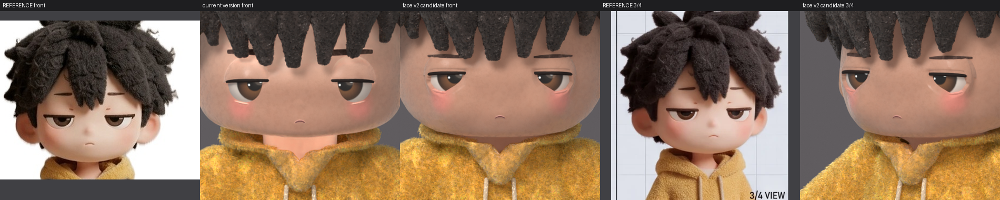
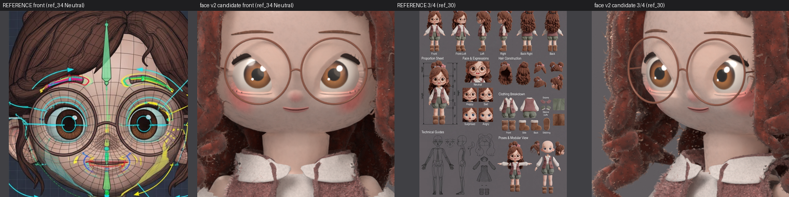
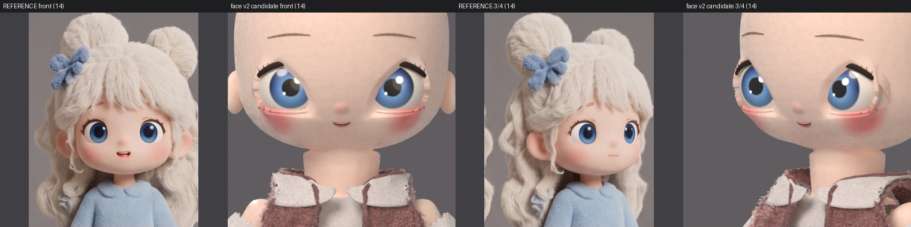
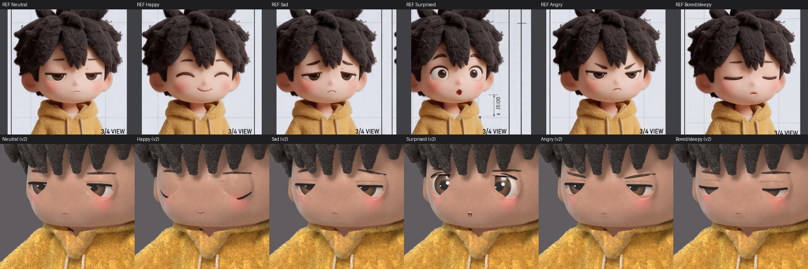
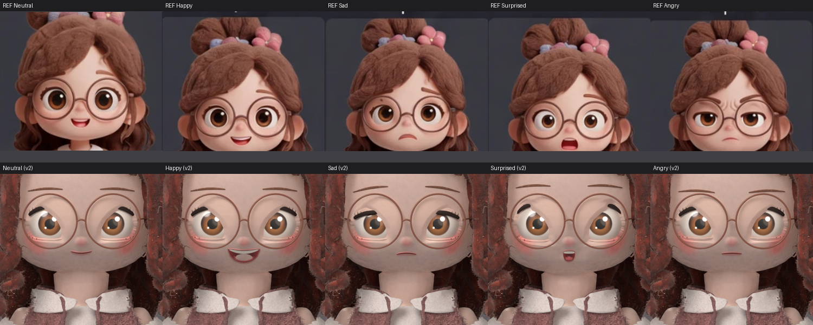

# T-065: face v2 — `face_generic/2` (opt-in)

Branch `t-065-claude-face-v2` (from `origin/staging`, staging merged in before the report). Path B: the candidates below
are **evidence for the owner's visual review only**. No character spec, preset or hair file was changed; nothing is
published, promoted or pinned.

Blender used: the bpy **5.3.0** module (Python 3.13) behind a `blender` wrapper (no Blender binary in the container).
Renders: Cycles CPU, 16 spp + OIDN, 384 px, orthographic face framing, shared calibration `character_neutral/1`.

## Result in one look





Sheets (reference row on top, candidate below):

- Boy front / 3/4: [boy_face_vs_reference.png](boy_face_vs_reference.png). Panels: char_C | current 2.0-dev (`face_generic/1`) | v2 candidate | #28 r1c1 | v2 3/4.
- Boy expressions (#28 tiles, 3/4 at 25°): [boy_expressions.png](boy_expressions.png). Shows Neutral, Happy, Sad, Surprised, Angry, Bored/sleepy.
- Girl front / 3/4: [girl_face_vs_reference.png](girl_face_vs_reference.png).
- Girl expressions (ref_34 matrix): [girl_expressions.png](girl_expressions.png). Shows Neutral, Happy, Sad, Surprised, Angry.
- Third character front / 3/4: [third_face_vs_reference.png](third_face_vs_reference.png).
- Third character expressions: [third_expressions.png](third_expressions.png). These are **workbench geometry previews, not Cycles** (render budget, see below). They show Neutral soft smile, Happy, Sad, Surprised, Angry, Sleepy and the parted-lips rest.

Single stills are in `renders/<who>/<Preset>_<yaw>.png`.





## What face_generic/2 does (code: `pipeline/charsys/face_generic.py` `build_v2`, `pipeline/charsys/face_features.py` "face_generic/2")

A spec opts in with `generators.face = "face_generic/2"` (and `face.generator` the same). `face_generic/1` is untouched:
`build()` hands a v2-pinned spec to `build_v2` before any v1 code runs. Every v1 helper `build_v2` reuses is called
unchanged, and v2 only adds new functions. So every existing character builds byte-identically (see Gate).

1. **Lids blended into the skin** (`face.eyes.socket`, AC 1).
   - The head mesh is refined around each eye: a smooth subdivision, so the original vertices do not move.
   - In each eye's frame, the skin wraps the lid shells:
     - inside the opening, skin in front of the eyeball moves behind it;
     - from each lid edge, for `band_deg` / `lower_band_deg`, the skin stays behind the shell. That band is the visible lid with its lash line;
     - over `ramp_deg` the skin then rises to just outside the shell (`clearance_m`). Where it crosses the shell is the soft crease;
     - beyond that it is a smooth maximum of the face and the shell, so it only rises where the shell would show, then blends back to the face.
   - Upper and lower profiles blend smoothly at the eye corners. Beyond `corner_deg` the skin only covers the shells.
   - A light Laplacian pass smooths the covered skin.
   - The lids keep the face skin material.
   - Blink, squint and the smile's lower-lid lift slide the lid out from under the crease, as real lids do, so the skin stays put.
   - EyeWide retracts the lid under the crease, so the socket skin rotates with it. This is a head shape key `EyeWide` with weights over the eye's width.
   - The lower lids ride on the cheek skin: the head's `MouthSmile`/`CheekRaise` displacement is copied onto the lower-lid shells.
   - Diagnostic in the build report, `lid_shell_exposed`: the share of each shell visible from the front.
     - Upper shells: 2–4 % (only the band shows).
     - Lower: 1–18 %. That is the band plus the inner surface of large lower lids.
2. **Round, full-cheeked faces** (`face.shape`, AC 2).
   - `outline_roundness`/`outline_exponent`/`outline_top_below_eye_m`: the front-view lower outline moves towards a superellipse.
   - `face_width_m`.
   - `lower_face_length_m`: stretch or shorten eye→chin. The neck below fades.
   - `lower_face_recede_m`: side profile, the face curves back towards the chin.
   - `cheek_fullness_m` (+ v1 `cheek_roundness_m`): bulge along smooth radial directions. v1's normal brush left bumps on the girl's coarse cheek; v2 does not use it.
   - `jaw_depth_roundness`.
   - v1 chin/forehead options still apply.
   - New action unit **`CheekRaise`** (`face.cheeks`).
   - New rest shapes in `face.mouth.rest_shape`:
     - **`soft_smile`**: MouthSmile 0.35 + CheekRaise 0.6 by default. It is the closed gentle smile with cheek lift (owner decision);
     - **`parted`**: the third character while watching.
   - `rest_mix` is honoured for every rest shape. This fixes T-055 limitation 1.
   - `MouthSmile`, `MouthFrown` and `CheekRaise` keep their absolute targets over a baked rest, so Frown and Sadness are not weakened.
   - The smile coupling's hard front cut-off on the head is tapered (no step on the cheeks).
3. **Brows** (`face.brows.shape`, AC 3).
   - Presets: `flat_stroke` (boy), `soft_arch` (girl), `short_arc` (third). The spec's own values override the preset.
   - Soft strokes tapered at both ends with round caps.
   - Acting keys as v1 plus `brow_sad_outer`.
   - Visibility under the fringe is spec data (`height`). For the boy it is now 0.72 r, just under the fringe tips, so Sad and Angry read.
4. **Eyes** (AC 4).
   - Size, spacing and height come from the existing spec keys.
   - v2 is tested with the third character's 46 mm wide-set eyes (centres 134 mm apart) and flattened eyeballs (`scale` y 0.78–0.8). The gaze envelope is honoured.
   - Iris per spec: boy dark brown, girl brown, third blue (checked).
5. **Mouth** (AC 5).
   - `face.mouth.fullness` {upper, lower, forward_m, lower_forward}: fuller, pillowed lips. The outer edge stays on the skin, and all keys keep their relative motion.
   - Boy: small pout as before (`rest_shape: pout`).
   - Girl: wider fuller soft smile.
   - Third: `parted`.
6. **Compatibility** (AC 7).
   - Same rig controls and engine expression map as v1 (T-046 face layer).
   - T-058 per-side units and MouthPout unchanged (`split` runs after the v2 steps). The boy candidate has all of them.

## Candidates (spec data in this folder; not character spec versions)

`candidates/*.override.json` are applied on top of the current specs by `build_candidate.py`. This driver registers
`face_generic/2` in-process. The registry line belongs in `pipeline/charsys/versions.py`, which is outside this task's
write-set (see "Needed from the Supervisor").

| Candidate | Base | Main face values |
| --- | --- | --- |
| Boy 2.0-dev + face v2 | `boy_yellow_hoodie.2.0.0-dev.spec.json` | round outline (exp 2.3), lower face +12 mm, recede 16 mm, cheeks 11 mm; eyes flattened 0.8, protrusion 0, lower lid −34°; socket band 9°/6°; brows `flat_stroke` at 0.72 r; skin occlusion lift 0.35 / bleed 0.2 (was 1.6 / 0.72: creases glowed white) |
| Girl next + face v2 | girl spec + 0.10.0 override | outline 0.6, cheeks 15 mm, recede 10 mm; eyes flattened 0.8, protrusion 4 mm (was 13.2); brows `soft_arch`, lighter; `soft_smile` with CheekRaise; lips wider (19 mm half width) and fuller (upper ×1.3, lower ×1.6) |
| Third character head-only test | girl body, no hair, no glasses | pale skin (248, 218, 204); blue iris; eyes r 46 mm, 134 mm apart, 16 mm lower; `short_arc` brows; tiny mouth, `soft_smile` rest; variant `third_headonly_parted_face2.override.json` = `parted` rest |

Rebuild:

```text
blender -b --factory-startup -P docs/evaluation/characters/T-065/build_candidate.py -- --spec <spec> [--override <0.10.0>] --override docs/evaluation/characters/T-065/candidates/<candidate>.json --out <dir> --no-glb --no-compare
```

Render:

```text
blender -b --factory-startup -P docs/evaluation/characters/T-065/render_face.py -- <master> <out> --shots "Neutral@0,Neutral@30,Smile@25"
```

Sheets:

```text
python3 docs/evaluation/characters/T-065/make_sheets.py docs/evaluation/characters/T-065/renders docs/evaluation/characters/T-065 [<baseline dir>]
```

## Judged against the references (visual first)

**Closer than before [J]:**
- **Lids.** The pale shell domes and goggles are gone on all three. The upper lid reads as a skin band with the lash line and a soft crease above. Happy and Blink close with skin, not black arcs on pale domes.
- **Boy.**
  - The lower face is a round U, as in char_C and the #08 bald head. The chin is softer and the boxy jaw corners are gone.
  - The neck under the chin is now hidden.
  - Brows are visible, so Sad and Angry read as in #28. Bored keeps the heavy lid.
- **Girl.** No grey goggle shading inside the glasses. Soft arched light brows. A closed gentle smile with lifted cheeks and fuller lips.
- **Third character.** Big blue wide-set eyes set into a round full-cheeked face, a tiny nose and a tiny soft-smile mouth. This is recognisably the "14" face construction.

**Remaining differences (honest list):**
1. **Skin colour/material.** Not this task (T-066).
   - The boy is still brown/olive instead of porcelain-peach.
   - The girl's skin is pale grey-pink.
   - I only lowered the candidates' occlusion lift/bleed, because the felt "crease glow" made the new creases bright.
2. **Lower lid band.** On the girl and the third character it reads as a thin bright pink/white line under the iris. The reference has a soft shadowed lower lid. Cause: the lid shell's rim and the lower band catch light. Lowering `lower_band_deg` or a darker lid rim material would help; not tuned within budget.
3. **Third character's upper lid** sits high (40°), so white shows above the iris. In "14" the lid touches the iris top: `upper_edge_deg` about 25–30°. Spec data, not tuned within budget.
4. **Boy Happy:** the closed eyes show as arcs at the outer half plus a faint ring of the closed shell. In #28 they are thin even arcs.
5. **Boy face shape.**
   - The 3/4 cheek is still flatter than #28. #28 has more cheek volume below the eyes.
   - The head stays wide and the forehead high: the body loft, not this task.
   - The ears sit high.
6. **Girl.**
   - The cheek shape is close, but the head and neck proportions (long neck, narrow chin) are body data (T-059).
   - Happy is still the library open smile, smaller than ref_30.
   - Angry brows are not as strongly furrowed as ref_34 "Anger" (needs a larger `brow_down_m` in her spec).
7. **Surprise (EyeWide)** stretches the socket skin. A slight fold shows at the inner corner on the boy (30° lid travel).
8. **Brows behind the fringe** are placement only. A fringe keep-out above the brows belongs to hair v3 (T-044).
9. **Fidelity scores were not run** (judgement first, per the owner). T-064 owns the fidelity tool fixes.

## Tests

- `python3 pipeline/charsys/tests/test_face_v2.py --blender <bpy wrapper> --boy/--girl/--third <masters>`: **33/33 PASS**.
  - Unit checks:
    - pin dispatch;
    - declaration;
    - brow presets;
    - rest shapes;
    - released-key bake semantics;
    - v1 build source reaches no v2 code.
  - Build checks per candidate:
    - generator /2;
    - upper shells ≤ 8 % visible;
    - no warnings;
    - EyeWide socket key;
    - T-046/T-058 controls and the engine expression map;
    - CheekRaise;
    - soft-smile corner lift 3.1–3.5 mm;
    - third: no eye overlap, blue iris.
- Gate (GitHub "Quality gate" run 44195415311 on `2315636`, after `git merge origin/staging`): Frozen assets, Write-set
  (17 paths, all in the claim), Shared-systems lint, C++ build, C++ tests, Python tests and links, Blender tier (full;
  regression + unchanged-character guard jobs for boy, girl, third character: all PASS) **PASS**. **FAIL only:** Guarded
  paths, `pipeline/charsys/tests/test_face_v2.py` (new test, needs Supervisor approval), and the derived "Merge status"
  line that follows from it. Locally (bpy wrapper) the same, plus C++ build (embree not installed in this container) and
  `OWNERSHIP.md parses` (the staging claims table had no rows at that moment); `test_export_engine` passed after fixing
  the local wrapper to print `SystemExit` messages.

## Render budget (24 Cycles stills, all used)

| Stills | Purpose |
| ---: | --- |
| 1 | boy 2.0-dev baseline (the "current version" panel) |
| 4 | first Cycles check of the boy's blended lids |
| 1 | third character close-up: checking a workbench artefact |
| 7 | boy final: front, 3/4, Happy, Sad, Surprised, Angry, Bored |
| 3 | girl, **discarded** (built with a refinement bug, since fixed) |
| 6 | girl final: front, 3/4, Happy, Sad, Surprised, Angry |
| 2 | third character final: front, 3/4 |

- Workbench (OpenGL, geometry only, no Cycles) previews were used for iteration and for the third character's expression sheet.
- The boy's 7 final stills come from the build just before two fixes: refinement without the whole-mesh relax, and the socket smoothing pass. The final code's boy face surface differs from it by at most 0.43 mm (p99 0.21 mm, under 1 px at this framing). Measured by nearest-surface distance over 26 k face vertices.
- Not rendered in Cycles:
  - girl bored/sleepy;
  - the third character's expression set (workbench only).

## Needed from the Supervisor / other tasks

- **`pipeline/charsys/versions.py`**: append `_r("face", "face_generic", 2, "face_generic")`. This is outside the write-set; `build_candidate.py` and the test register it in-process meanwhile.
- **Character spec versions** for an owner-approved pin bump (path B). The candidate overrides here are the data to start from.
- **T-044 (hair)**: a fringe keep-out above the brows, so brow acting stays visible.
- **T-066 (skin)**: a skin preset that keeps creases warm but not glowing. The candidates turn the felt occlusion lift/bleed down.
- No `presets.json` change is needed for face v2.
