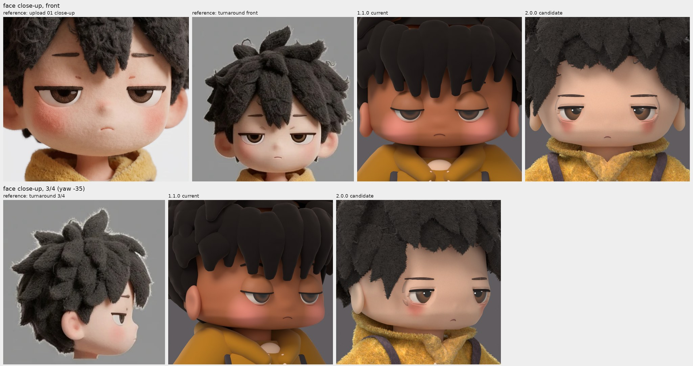
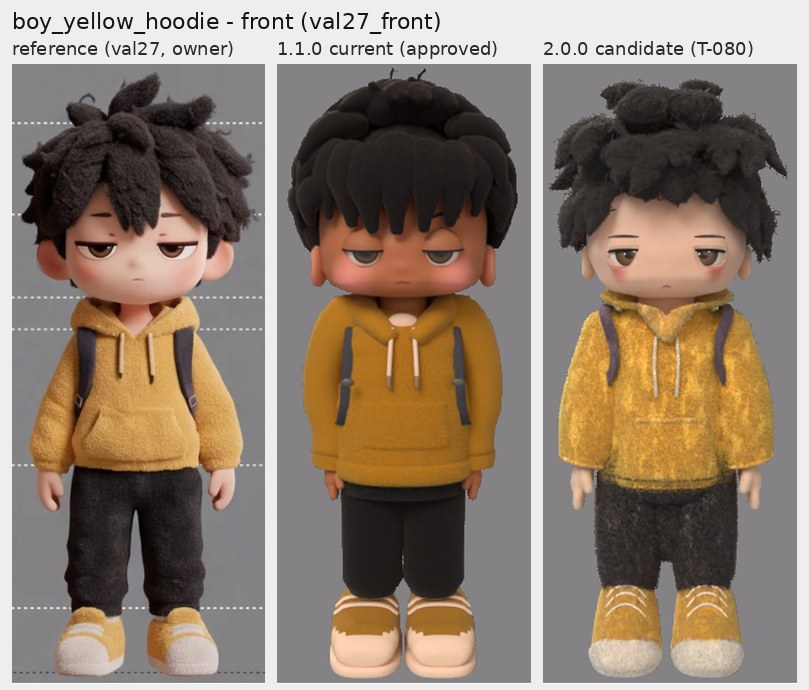

# T-080: boy 2.0.0, all approved improvements in one new version

Implementer: Claude (cloud) · lane D · **path B** · branch `t-080-claude-boy-2-0-0` (from `origin/staging`, staging
merged in before the report). Blender: **bpy 5.3.0 module** (Python 3.13 venv) through `tools/bpy_blender.py`; no
Blender binary in the container.

## 1. Task
T-080 builds boy version **2.0.0**, which combines:
- face v2 with the fitted head;
- skin `presets/2`;
- hair v3 **round 3** (T-079 data). The task file said round 2, but the Supervisor changed this on 2026-11-18: use round 3, the latest and most reference-faithful;
- sneakers, backpack and the hood/underarm fix;
- personality profile 1.0.0.

Visual fidelity to the references comes first. 2.0.0 is **not** made current: 1.0.0 and 1.1.0 are unchanged.

## 2. Result
**Complete, path B (owner review on renders).**
- `boy_yellow_hoodie.2.0.0.spec.json` builds on the generic path.
- It exports to the engine. Its fidelity score is **67.63**, against the approved 1.1.0 baseline of 66.41 (+1.22). With round-2 hair it was 67.51.
- 2.0.0 is not pinned anywhere: `fidelity_baseline.json`, the published versions and `assets/characters/*/versions/` are untouched.
- Gate: see §5.1.

## Owner sheets (reference | 1.1.0 current | 2.0.0 candidate)

- **All views:** [sheets/owner_sheet.jpg](sheets/owner_sheet.jpg)
- **Per view:**
  - [front](sheets/sheet_front.jpg)
  - [3/4](sheets/sheet_34.jpg)
  - [side](sheets/sheet_side.jpg)
  - [back](sheets/sheet_back.jpg)
  - [face close-ups, front and 3/4](sheets/sheet_face.jpg). Reference columns: the close-up upload `01_*` and the 2026-11-17 turnaround.
- **Turnaround reference strip:** [sheets/reference_turnaround_boy.jpg](sheets/reference_turnaround_boy.jpg)




How the stills were made:
- **Body views:**
  - Made with the fidelity tool's cameras: the val27 reference views, compare variant (arms down), `character_neutral/1`, 640 px, 32 spp + OIDN.
  - The 2.0.0 panels come from this task's fidelity run with round-3 hair.
  - The 1.1.0 panels are cropped from the stored T-064 baseline sheets (`docs/evaluation/characters/T-064/boy/sheets`). These are the renders the current baseline score of 66.41 was measured on, so no re-render was needed.
- **Face close-ups:** `groom_turnaround.py --closeup`, front and yaw −35, centre z 0.80, width 0.36 m, 640 px, 32 spp. Both versions were built in this session.
  - The 2.0.0 close-ups are from the final round-3 build. They were re-rendered after the switch, under the Supervisor's re-render allowance of ≤ 10 stills for the round-3 update; see §10.

## 3. Files changed
| Path | Purpose |
| --- | --- |
| `assets/characters/boy_yellow_hoodie/spec/boy_yellow_hoodie.2.0.0.spec.json` | NEW: the 2.0.0 spec. It is one self-contained file, generated by `make_spec.py`. |
| `pipeline/charsys/versions.py` | Registers `materials presets/2` → `materials.builder`, `declared=False`. It is one appended line; no existing line was changed. |
| `docs/evaluation/characters/T-080/inputs/boy.hair_v3.r3.json` | Unchanged copy of T-079's `candidates/boy.hair_v3.json` at `t-079-claude-hair-v3-r3@7d3c424`. T-079 is not in staging yet. After T-079 merges, `make_spec.py` can point at T-079's file directly. |
| `docs/evaluation/characters/T-080/make_spec.py` | Composes the spec from the 2.0.0-dev spec and the candidates. All conflict choices live in this file. `--check` verifies that the spec file is up to date. |
| `docs/evaluation/characters/T-080/make_sheets.py` | Makes the owner sheets. |
| `docs/evaluation/characters/T-080/sheets/*.jpg` | Owner sheets. |
| `docs/evaluation/characters/T-080/fidelity/{fidelity.json,report.md,sheets/*.jpg}` | Fidelity measurement for 2.0.0 and its per-view tool sheets. |
| `docs/evaluation/characters/T-080/README.md` | This report. |

No generator, preset, personality or frozen file was changed.

## 4. What the 2.0.0 spec contains

**Generators:**

| Feature | Pin |
| --- | --- |
| body | `body_generic/2` |
| face | `face_generic/2` |
| groom | `groom/2` |
| garment | `garment/1` |
| accessories | `none` |
| rig | `rigify_human/1` |
| materials | `presets/2` |
| exporter | `export/4` |

Every section comes from the approved candidates, applied to `boy_yellow_hoodie.2.0.0-dev.spec.json`:

1. **Face v2 + fitted head.** From the T-065 `boy_2.0-dev_face2.override.json`, unchanged: layout, cheeks, eyes, lids, socket, flat-stroke brows, and the body_generic/2 head outline.
2. **Skin.** From T-066:
   - `skin-felt/2` with porcelain-peach 236/190/166, used for both the skin slot and the face albedo;
   - blush 226/128/112.
   - On the generic path `materials.assignments` applies directly. No post-build step is needed, unlike on 1.1.0.
3. **Hair v3 round 3.** T-079's boy data (copied into `inputs/`): top whorl, upright crown leaves, no horn tufts. Its `felt hair` material (25/22/21) is unchanged. It needs no new groom keys and validates with the staging `groom_hybrid` (T-079 changed code only for the scalp-cap weight fix). The `hair_clumps/1` section of 2.0.0-dev is replaced as a whole.
4. **Garment details.** T-068's clothing, taken as a whole. I checked that it is a strict superset of 2.0.0-dev's clothing:
   - hood volume and `armhole: closed`;
   - trousers length 0.985;
   - shoes changed to the `sneakers` type;
   - a new `backpack` garment.
5. **Personality.** `animation.personality = {profile: boy_yellow_hoodie, profile_version: 1.0.0, path: content/personality/boy_yellow_hoodie.json}`.
   - This is a data reference only. The engine reads the profile through a scene character's `"personality"` field.
   - No profile file was changed.

**Conflict choices.** These are also stored in the spec under `metadata.choices`:

- **Face skin occlusion `bleed`:** 0.0 instead of T-065's 0.2.
  - `presets/2` is non-emissive by rule and removes the bleed anyway.
  - The references (upload 01, canon29) show no glowing creases.
  - T-065's `lift` 0.35 is kept.
- **Blush:** T-066's colour, with T-065/2.0.0-dev's placement and intensity kept.
- **Hair frame:** the generic path takes it from the body head parameters. Centre (0, 0.010, 0.855), radii (0.160, 0.152, 0.159); T-070/T-079 tuned on (0, 0.008, 0.855) / (0.160, 0.154, 0.159). The difference is ≤ 2 mm, so no data change was made.
  - Build report: keep-out 0 violations.
  - Round-3 structures: whorl 5, crown 9, top 14, fringe 4 + 1, sides 10, back 19 clumps.
- **Exporter:** `export/4` kept, as in 2.0.0-dev and girl 0.10.0. `export/5` would be a separate decision.
- **Backpack kept.** It is in val27/char_C/#08 (fidelity front reference), but **not** in the 2026-11-17 turnaround or upload 01. The task lists it as approved. The owner may want to confirm that it belongs on the default version.

**Supervisor's groom/2 export bug note.** Checked on this build:
- `export_engine.py` on the plain 2.0.0 master succeeds: round 3 gives 170 bones, 78 meshes, 315 morph blocks, 23.7 MB (round 2 gave 152 bones, 77 meshes).
- T-078's `clean_stale_weights.py` finds **no** stale entries.

The normal generic build runs `groom_hybrid.bind` on its own hair objects. The stale indices therefore seem to come only from T-070's post-build `build_candidate.py` path on an already-built master. No workaround is used or committed in T-080.

## 5. Tests
| Command | Result |
| --- | --- |
| `python3 docs/evaluation/characters/T-080/make_spec.py` | Spec validates (`spec.validate`, including the presets/2 skin assignment and the pins); sha256 `939863f6…` (round 3) |
| `blender … build_character.py -- --spec …2.0.0.spec.json --out <tmp> --no-glb` | Builds master + compare (arms down) in about 1 m 45 s. Hair keep-out 0. Material presets: skin `skin-felt/2`, hair `felt hair` |
| `blender … export_engine.py -- --blend <2.0.0 master> --profile humanoid_rigify.json` | PASS (see §4) |
| `python3 tools/fidelity/run.py --character boy_yellow_hoodie --build <2.0.0 master>` | **67.63** (compare variant, round 3; round 2: 67.51). Baseline 1.1.0: 66.41 |
| `python3 pipeline/charsys/tests/test_versions.py` | ALL PASS 83/83 |
| `python3 pipeline/charsys/tests/test_skin_presets.py` | PASS 24/24 (approved versions still name no presets/2 id) |
| `python3 pipeline/charsys/tests/test_hair_v3_r2.py` | ALL PASS 20/20 (T-079's r3 tests are on its own branch, not in staging) |
| `python3 pipeline/charsys/tests/test_material_presets.py` | ALL PASS 54/54 |

Not run:
- Animation regression shots (idle, walk, wave, hand-over) with 2.0.0. `run_shot` cast "current" is still 1.1.0, and 2.0.0 is not current.
- The engine solver on the new hair and backpack.

### 5.1 Gate
Command (full tier, this container):

`python3 tools/check_all.py --base origin/staging --task T-080 --artifacts-dir <tmp> --blender <bpy wrapper>`

| Check | Result |
| --- | --- |
| Frozen assets | PASS |
| Guarded paths | PASS (no guarded paths touched, so none needs approval) |
| Write-set | PASS (20 paths, all inside the T-080 claim) |
| Shared-systems lint | PASS |
| C++ build / C++ tests | FAIL **environment**: CMake cannot find `embree` 4 in this container, so no C++ was built or run. Same as T-066. T-080 changes no C++ file; GitHub CI on the branch is the evidence. |
| Python tests and links | PASS. An earlier run failed on documentation links in my copied fidelity `report.md`; I fixed it in `5405684`. |
| Blender tier (full) | **PASS**. Regression: boy_yellow_hoodie PASS (fidelity 66.42, unchanged-character guard); girl_auburn_bun_glasses PASS (64.40); girl_white_hair_blue_dress PASS |

This is the final run on `ee610a3`: round-3 hair, with staging merged in.

Paths failing only for the environment: the C++ build and tests (embree). Nothing else is guarded or failing.

Note: `fidelity/fidelity.json` still names the sheets with their original `.png` names from the tool run. The committed copies are `.jpg`.

### Fidelity subscores (support only; the sheets decide)
| | 1.1.0 (T-064 baseline) | 2.0.0 (round-2 hair) | **2.0.0 (round-3 hair, final)** |
| --- | --- | --- | --- |
| **score** | 66.41 | 67.51 | **67.63** |
| colour | 0.601 | 0.748 | 0.751 |
| face | 0.830 | 0.716 | 0.701 |
| hair | 0.648 | 0.678 | 0.680 |
| landmarks | 0.798 | 0.824 | 0.816 |
| proportions | 0.608 | 0.596 | 0.599 |
| regions | 0.651 | 0.604 | 0.602 |
| silhouette | 0.671 | 0.670 | 0.686 |
| skin | 0.562 | 0.481 | 0.481 |
| texture | 0.586 | 0.745 | 0.729 |
| figure IoU / landmark NME / colour dE00 | 0.836 / 0.061 / 7.97 | 0.835 / 0.053 / 5.04 | 0.843 / 0.055 / 4.98 |

Tool caveats (data outside this write-set):
- **Backpack scores 0.** The boy's `fidelity_index.json` region rules call the backpack `accessory:backpack`. The fidelity render side maps the new garment object `garment.backpack.*` to `garment:backpack`, which the reference annotations do not have. So the backpack scores IoU 0 and pulls `regions` down.
- **Rule fix:** `["garment.backpack*", "accessory:backpack"]` in the boy's fidelity index fixes it. This is for the Supervisor.

## 6. Baselines
- `git diff origin/staging...HEAD` touches only the files in §3. No changes to:
  - `boy_yellow_hoodie.spec.json`, `1.1.0.override.json`, `2.0.0-dev.spec.json`;
  - `versions/`, `fidelity_baseline.json`;
  - any generator, preset, personality or frozen file.
- `versions.py` only appends a registration. The legacy defaults (`LEGACY_FIELDS`, `legacy_default`) are unchanged, so no existing spec resolves differently. `test_versions.py` passes.
- The gate's unchanged-character guard for every character: §5.1.

## 7. Visual results vs the references

**Better than 1.1.0:**
- **Skin:** porcelain-peach, matte, no glowing creases (upload 01, turnaround). 1.1.0 is tan/orange.
- **Hair:** charcoal felt leaves with fibre wisps and a broken, star-like outline. 1.1.0 is a smooth sculpted helmet.
- **Eyes:** brown iris with a heavy upper lid and flat-stroke brows; reads as the bored look of the references.
- **Fleece texture:** on the hoodie and trousers.
- **Sneakers:** cream soles, toe caps and laces, as in upload 01. 1.1.0 has blob shoes.
- **Hood:** a pillow at the back instead of a flat flap; no underarm hole.

**Remaining differences, most visible first:**
1. **Eyes too small.** The fidelity eye area is 0.56 × the reference. The reference eyes are larger almond shapes with more white showing. This is face v2 data (`eyes.radius_m`, lid gaps). I did not change it because it is the approved T-065 state.
2. **Cheeks/face.** The reference face is wider and rounder at the cheeks, with strong rosy blush patches. 2.0.0's cheeks are narrower, and its blush is smaller and paler.
3. **Faint ring around each eye.** This is the socket/lid edge in the face v2 skin, visible in the front close-up. Known from T-065.
4. **Hair (round 3).** Much closer than round 2: upright pointed crown leaves from a top whorl, and a central fringe clump toward the brows (face sheet). Still different:
   - The outline is larger and wider than the reference (hair outline log2 +0.57).
   - The crown leaves are thinner and more scattered than the reference's few broad petals.
   - The side/back mass is fuller.
5. **Hoodie colour/texture.** The fleece reads mottled and more orange-saturated than the reference's even mustard. This is the `fleece` preset / colour data from T-058/T-068, not changed here.
6. **Sneaker colour.** The upper is more saturated yellow than the reference (shoes dC +15).
7. **Backpack:** see §4. It is not in the turnaround or upload 01.

## 8. Problems and open questions
1. The fidelity backpack rule (§5) is for the Supervisor.
2. The owner should decide whether the backpack belongs on the default 2.0.0, given the turnaround and upload 01.
3. Eye size and cheeks (§7 items 1–2) could get a data-only follow-up on the 2.x line, with owner approval of the face change.
4. The groom/2 export bug does not reproduce on the generic build path (§4), with either round. The T-079 fix is still needed for the post-build candidate tool.
5. **Merge order:** `inputs/boy.hair_v3.r3.json` duplicates T-079's candidate file. If T-079 changes that data before it merges, re-run `make_spec.py` (or point it at T-079's file).

## 9. Commits
Branch `t-080-claude-boy-2-0-0`:
- `4d23142`: spec + versions.py;
- merge of `origin/staging` (`294cee5`);
- `53ae8ac`: sheets, fidelity, scripts;
- `5405684`: report, doc-links fix (first READY, round-2 hair);
- `ee610a3`: round-3 hair, fidelity and sheets updated;
- `39aa35c`: report for round 3, final gate;
- the round-3 close-ups commit (see the RELAY_LOG line).

## 10. Resource use
- **Token usage:** not available.
- **Cycles evidence-quality stills (32 spp): 26 in total.**
  - First round, 19 of the 24 allowed:
    - 5: 2.0.0 round-2 fidelity (compare); superseded by round 3, kept as the round-2 comparison.
    - 4: close-ups (2 per version); the 2.0.0 pair was superseded by round 3.
  - Round-3 update, 7 of the ≤ 10 the Supervisor allowed:
    - 5: round-3 fidelity (compare), used.
    - 2: round-3 face close-ups, used.
  - **10 wasted:**
    - 5: a first 2.0.0 fidelity run on the A-pose master. I built with `--no-compare`, so there was no compare variant. Score 60.65, not comparable.
    - 5: a 1.1.0 fidelity run with the same mistake (60.13).
  - The 1.1.0 body panels reuse T-064's stored baseline renders instead of a re-render.
- **Not evidence:** 8 low-sample preview tiles (6–8 spp).

## Reproduce
```sh
B=<blender or bpy wrapper>; W=<scratch>
python3 docs/evaluation/characters/T-080/make_spec.py --check
$B -b --factory-startup -P pipeline/charsys/build_character.py -- \
  --spec assets/characters/boy_yellow_hoodie/spec/boy_yellow_hoodie.2.0.0.spec.json --out $W/b20 --no-glb
python3 tools/fidelity/run.py --character boy_yellow_hoodie --build $W/b20/boy_yellow_hoodie_master.blend --blender $B --out $W/fid20
# 1.1.0 for the close-ups: build_character.py --spec …/boy_yellow_hoodie.spec.json --override …/1.1.0.override.json --out $W/b11
for v in 11 20; do $B -b --factory-startup -P pipeline/charsys/tools/groom_turnaround.py -- $W/b$v/boy_yellow_hoodie_master.blend \
  <empty {"views":[]}> $W/cu$v --height 640 --samples 32 --closeup 'front:0:0:0,0,0.80:0.36' --closeup 'q34:-35:0:0,0,0.80:0.36'; done
python3 docs/evaluation/characters/T-080/make_sheets.py $W/fid20/sheets $W/cu11 $W/cu20 docs/evaluation/characters/T-080/sheets
```
