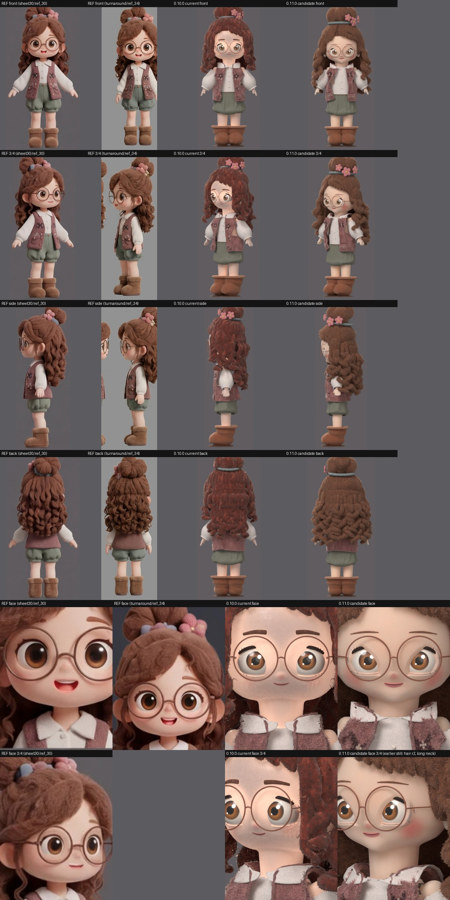
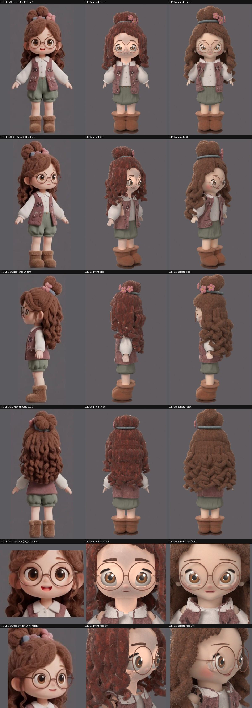

# T-081: girl 0.11.0, all approved improvements in one girl version (girl look round, T-059)

Implementer: Claude (cloud) · lane D · **path B** · branch `t-081-claude-girl-0-11-0` (from `origin/staging`).
Blender: **bpy 5.3.0 module** (Python 3.13 venv) through `tools/bpy_blender.py`; no Blender binary in the container.
Renders: Cycles CPU + OIDN, shared calibration `character_neutral/1`. Workbench previews (lavapipe) were used for
geometry iteration only; they are not evidence.

## 1. Objective
A new girl version `0.11.0` that combines every approved improvement: face v2 with the fitted head, skin presets/2,
hair v3 round 3 (T-079; the Supervisor asked for it in place of round 2), vest details and the personality profile. It also fixes the sharp cheek folds and applies the T-059
targets the systems now allow. Approved 0.10.0 stays unchanged and stays the current version.

## 2. Result
**Complete, path B (owner reviews the renders).**
- `0.11.0` builds, is fully rigged, and exports a GLB.
- It is **not** pinned as current: `fidelity_baseline.json` still names 0.10.0.
- The cheek and eye-corner folds are fixed by a new opt-in option in `face_generic/2`; its default is off.
- Remaining visual gaps are listed in §7, honestly.

## 3. Owner sheet

[girl_0.11.0_owner_sheet.jpg](girl_0.11.0_owner_sheet.jpg). Columns: references | 0.10.0 current | 0.11.0 candidate.
Rows:
- front, 3/4, side, back. References: sheet30 views and the girl row of the 2026-11-17 owner turnaround.
- face close-up. References: the ref_30 "Neutral" tile and the ref_34 "Neutral" tile.
- face 3/4. Reference: the ref_30 front-left view.

Single stills: `renders/0.10.0/*.jpg` and `renders/0.11.0/*.jpg` (round-3 hair). Both versions were rendered the same way: 400 px,
16 spp, orthographic, with `tools/render_views.py`.

**Cycles stills used: 34 in total.** That is 24 in the original budget plus the Supervisor's 10-still allowance for
the round-3 / neck rework. Breakdown:
- 1 iteration close-up.
- 12 sheet stills with hair round 2 (6 per version).
- 5 fidelity views (round 2).
- 5 round-3 stills before the neck fix (superseded, not on the sheet).
- 5 final stills for 0.11.0: 4 body views and the face front.
- 5 fidelity views for the final build.

The 0.11.0 **face 3/4 tile is an earlier still** (round-2 hair, long neck), labelled on the sheet.
The round-2 stills of 0.11.0 are kept in `renders/0.11.0_hair_round2/`.

## 3a. Strict comparison for the owner's decision (0.10.0 vs 0.11.0)

[girl_0.10.0_vs_0.11.0_strict.jpg](girl_0.10.0_vs_0.11.0_strict.jpg). Columns: original reference | 0.10.0 current |
0.11.0 candidate (final, 9f20c2d/6b18b3c).

How it was rendered:
- Both versions were rendered fresh **in one Blender run** (`tools/strict_render.py`).
- They share **identical fixed cameras**: not framed per model, perspective 70 mm, elevation 5°, with the yaw of each
  reference view from `reference_index.json` (front 0°, 3/4 −45° = sheet30 front-left, side 90° = sheet30 left,
  back 180°; face front 0°, face 3/4 −45° = ref_30 front-left).
- Same calibration lights (`character_neutral/1`), world and exposure; Cycles 16 spp + OIDN, seed 0; 360×576 px body,
  360×360 px face.
- Same rest pose (A-pose); every face control is at 0, which is each version's own neutral.
- No older stills are reused. The earlier owner sheet's 3/4 rows used +35°, the mirror of the reference's front-left;
  this sheet uses the reference yaw.
- Single stills and the camera record are in `strict/`. 12 new Cycles stills.

| View | Closer in 0.10.0 | Closer in 0.11.0 | Fidelity per view, 0.10.0 → 0.11.0 (figure IoU ↑ / landmark error ↓, head heights) |
| --- | --- | --- | --- |
| front | slightly tighter hair silhouette (IoU) | skin colour, hair colour (warm brown, not red-brown), ringlet shape, bun size and flowers, head on the collar (short neck), vest decals, softer face, blush | 0.847 → 0.810 / 0.049 → **0.043** |
| 3/4 | silhouette IoU (narrower hair mass) | hair colour and ringlets, round full cheek, blush, short neck, vest pockets | 0.842 → 0.796 / 0.065 → 0.076 |
| side | silhouette IoU | ringlet volume down the back, bun shape, skin, short neck | 0.778 → 0.743 / 0.055 → 0.059 |
| back | silhouette IoU | rounder high bun; ringlets curl as in the turnaround back (0.10.0 is a red, stringy curtain); hair colour | 0.868 → 0.852 / 0.096 → 0.113 |
| face front | darker, crisper upper lash line | porcelain-peach skin, no glowing creases or cheek specks, soft blush below the rims, fuller lips, round lower face, neck hidden by the collar | (no per-view face score; face part 70 → 69) |
| face 3/4 | — | skin, blush, round cheek, no grey goggle shading in the lens | — |

**Neither version** has the side-swept fringe over the forehead, the cream fleece boot cuff, or the reference's
large, round, wide-open eyes. The fidelity numbers favour 0.10.0's narrower hair silhouette. Visually, 0.11.0 is
closer in colour, material and hair shape. The owner decides; 0.10.0 stays current until then.

## 4. Files changed
| Path | Purpose |
| --- | --- |
| `assets/characters/girl_auburn_bun_glasses/spec/girl_auburn_bun_glasses.0.11.0.spec.json` | NEW: the 0.11.0 version, a complete spec (see §5.1) |
| `pipeline/charsys/face_features.py` | `lid_socket` (face_generic/2 only): opt-in `wall_smooth_iterations` / `wall_smooth_factor` (socket-wall relax) and `corner_blend_deg` / `corner_close_deg`. The last two name the former constants 10° / 12°; their defaults are exactly those constants. |
| `pipeline/charsys/tests/test_face_v2_socket_wall.py` | NEW test, 12 checks (§6) |
| `docs/evaluation/characters/T-081/tools/make_spec.py` | writes the 0.11.0 spec reproducibly from the base spec, 0.10.0, the candidates and the T-081 choices |
| `docs/evaluation/characters/T-081/tools/render_views.py` | evaluation renders (body/head/face views, Cycles or Workbench) |
| `docs/evaluation/characters/T-081/tools/make_sheet.py` | owner sheet |
| `docs/evaluation/characters/T-081/tools/strict_render.py`, `make_strict_sheet.py` | strict comparison: identical fixed cameras, one run |

Documentation and evidence: this README, `girl_0.11.0_owner_sheet.jpg`, `renders/`, and `fidelity/` (`fidelity.json`,
`report.md`, `overview.jpg`). Not changed: `face_generic.py`, `body_generic.py`, `body_helpers.py`, `versions.py`,
and every existing spec or override.

## 5. What was implemented
### 5.1 The 0.11.0 spec
Merge order, later wins:
1. frozen base spec
2. approved `0.10.0.override`
3. T-065 `girl_next_face2.override`
4. T-066 `girl_auburn_bun_glasses.skin2.override`
5. T-068 `girl.vest_details.override`
6. T-079 round-3 `girl.hair_v3.json` (its `overrides`), from branch `t-079-claude-hair-v3-r3@7d3c424`, which is not yet in staging. It is copied byte-for-byte to `inputs/girl.hair_v3_r3.json`; identical at 860f855 and 7d3c424.
7. the T-081 choices

The result is written by `tools/make_spec.py`.

- **Why a complete `.spec.json`, not an override:** `spec.deep_merge` can only add or replace keys. The base spec's
  groom/1 hair has dynamics entries for structures that groom/2 no longer has (`temple_puffs`, `side_curls`, …).
  groom/2 validation rejects them, so an override on top of the base cannot build. The hair section is therefore
  replaced as a whole by the T-079 hair, keeping the descriptive `components`.
  - `fidelity_baseline.json`-style use: `build` = the 0.11.0 spec, no overrides.
- **Generator pins:**
  - `body_generic/2`, `face_generic/2`, `groom/2`, `garment/1`, `accessories/1`, `rigify_human/1`, `export/4`.
  - `materials` stays `presets/1`. The skin-felt/2 preset id resolves through the presets/2 skin family by id
    (T-066 routing), and `presets/2` is not registered in `versions.py`. T-080 registers it; that file is read-only
    for this task. Once it is registered, switching the pin is a one-line follow-up (0.11.x).
- **Personality:** `animation.personality` = profile `girl_auburn_bun_glasses` 1.0.0 with its path (T-053). Scenes
  still opt in with `"personality"`.

### 5.2 Conflicts between candidates and how I resolved them (closer to the references wins)
| Topic | Candidates | Choice | Why |
| --- | --- | --- | --- |
| rest mouth | 0.10.0 `closed_smile` (frown −4.2 mm) vs T-065 `soft_smile` + rest_mix (MouthSmile 0.35, CheekRaise 0.8, frown −2.5 mm) | **soft_smile** (lips closed, no teeth/tongue; MouthWide 0) | owner decision "closed gentle smile at rest **with lifted cheeks**"; T-059 asks for cheeks lifted at rest; ref_34 Neutral |
| skin occlusion | T-065 lift 0.35 / bleed 0.2 vs T-066 lift 1.1 to warm (248,210,190) / bleed 0 | **T-066** | T-066 is the approved skin family and is non-emissive (no glowing creases) |
| blush | 0.9.0/T-065 vs T-066 | **T-066** (warmer, lower, out from the rims) | ref_30/ref_34 blush below the glasses rims |
| hair | base groom/1 vs T-070 round 2 vs T-079 round 3 | **T-079 round 3** in full | Supervisor message 2026-11-18 (owner rule: latest, most reference-faithful): swept soft fringe, more varied ringlets |
| eyes | base vs T-065 | **T-065** (protrusion 4 mm, scale y 0.8, socket); iris **brown** (128, 74, 38) kept | owner decision |
| vest | 0.9.0 embroidery flowers vs T-068 | **T-068** patch pockets + cross-stitch decals | #41 vest construction sheet |

### 5.3 Sharp cheek / eye-corner folds (task item 6)
Measured as the dihedral angle between neighbouring `body_skin` faces, front-facing edges only. The window is up to
60 mm sideways and 75 mm below each eye centre. "Cheek" means more than 1.25 eye radii from the centre; "corner" means
the eye's sides.

| Build | cheek max | corner max | corner edges > 45° |
| --- | --- | --- | --- |
| 0.10.0 (face v1; T-066's speckles) | **150.5°** (60 edges > 45°) | 40.8° | 0 |
| face v2 candidate as approved (T-065) | 23.1° | **92.2°** | 56 |
| **0.11.0** (wall smoothing 10 passes) | **22.2°** | **40.3°** | **0** |

- **The old cheek folds:** face v2 on the fitted head (`body_generic/2`) already removes the folds that T-066's fix
  report traced to the 0.10.0 cheek geometry.
- **What it left:** narrow pleats in the socket wall at the outer and lower eye corners. The wall is where the skin
  goes from the opening out to the crease. Pulling the refined, irregular cheek mesh radially onto the lid profile
  makes those pleats. Under the matte skin they shade as dark specks.
- **Isolating the cause** (8 head-only builds):
  - with the socket off, the corners measure 5°, so the socket pass makes the pleats;
  - none of these changed them: the rest mix, cheek fullness, `corner_deg`, `cover_softness`, more of the existing
    smoothing, or a wider corner blend.
- **Fix:** `face.eyes.socket.wall_smooth_iterations` (opt-in, default 0).
  - It runs a Laplacian relax over the socket wall and the covered skin; the opening's own vertices stay fixed.
  - 0.11.0 uses 10 passes. Upper lid shells stay 1.8 % visible; lower shells go from 13 % to 14.5 %.
  - With `cover_sides` added, the 3/4 shell ends are hidden better, but an 87° fold comes back at the corner, so it is
    not used.
- **Third character's 3/4 rim ("if cheap"): not fixed.**
  - The rim is the lid shells sticking out past the skin at the outer side in 3/4.
  - The real fix is shells that end at the eye corners, with their Blink motion adapted. That is not cheap (T-065
    reached the same conclusion).
  - The girl shows a little of it too, inside the glasses frame (§7).

### 5.4 T-059 targets applied (spec data only)
- mouth: half width 19 → 20.5 mm, lip height 2.8 → 3.4 mm, fuller (upper ×1.45, lower ×1.8, forward 1.4 mm), pinker
  lips (222, 142, 140); ref_34 mouth tiles;
- ears a little larger: radii (13, 25, 34) mm, were (11, 21, 29); sheet30 front;
- **neck (Supervisor review):** the head now sits on the collar as in sheet30 and ref_30, with almost no visible neck.
  - The shoulder line, neck base and top torso levels are raised by 0.03 × height (29 mm): shoulder z and neck
    base_z 0.60309 → 0.63309; torso levels 5–6 +0.03, level 4 +0.015.
  - The neck is wider: radius 46.4 → 54 mm, top 55 → 61 mm.
  - The head, face, hair and glasses do not move.
  - Three variants were tested (workbench). Also lifting the blouse collar made the flaps stand up, so it is not used;
  - the garments refit through the garment/1 collision with no warnings;
- cheeks lifted at rest (soft_smile + CheekRaise 0.8), skin, eyes, vest and hair come from the candidates above.
  Boots are unchanged: no approved boot candidate exists, and garment/1 has no fleece-cuff option.

## 6. Tests executed
| Command | Result |
| --- | --- |
| `python3 pipeline/charsys/tests/test_face_v2_socket_wall.py --blender <bpy wrapper> --girl011 <0.11.0 master>` | **ALL PASS 12/12**: pins; brown iris; soft_smile rest with MouthWide 0 and CheekRaise > 0; personality 1.0.0 referenced; 0.11.0 not current; no other spec uses the new options; wall smoothing ran (9354 vertices); upper shells ≤ 8 % visible; cheek max 22.2°, corner max 40.3° (≤ 45°) |
| `python3 pipeline/charsys/tests/test_skin_presets.py` | PASS 24/24 (the approved versions still name no presets/2 id) |
| full build `build_character.py --spec …0.11.0.spec.json` (with GLB) | OK. Pins as §5.1; hair report without warnings |
| fidelity `tools/fidelity/run.py` (640 px, 32 spp, as the baseline) | **final 0.11.0 (round-3 hair, neck fix): 62.29**. Baseline 0.10.0: 64.40 (**−2.1**, just past the 2-point regression policy, which applies to the current version; 0.11.0 is a candidate). Intermediate round-2 build: 62.81 |
| `python3 tools/check_all.py --base origin/staging --task T-081 --blender <bpy wrapper>` | see §6.1 |

Fidelity parts, final 0.11.0 vs 0.10.0:
- figure IoU 0.796 (was 0.825);
- landmarks 0.087 (was 0.080);
- proportions 12.3 % (was 11.4 %);
- colour dE00 5.79 (was 5.73);
- texture 0.48 (was 0.39);
- hair sub-score 60 (round 2: 59).

The sheets are in `fidelity/`.

Ranked differences (fidelity/report.md):
- gap between the legs too long;
- hair accessory area +123 %;
- hair over 27 % of the face that the reference leaves visible;
- arms short;
- blouse and vest silhouettes smaller.

The hair items come from the hair data (T-079 round 3: hair accessory area +110 %, hair over 25 % of the face the reference leaves visible). The blouse silhouette got smaller after the shoulder raise (−45 %). The leg and arm items are older and unchanged. The body proportion items
are older and unchanged here.

### 6.1 Gate
`python3 tools/check_all.py --base origin/staging --task T-081 --artifacts-dir <tmp> --blender <bpy wrapper>` (full tier):

| Check | Result |
| --- | --- |
| Frozen assets | PASS |
| Guarded paths | FAIL: **needs Supervisor approval** of the new `pipeline/charsys/tests/test_face_v2_socket_wall.py` (a new test in a guarded area, inside the T-081 claim) |
| Write-set | PASS (7 paths, all inside the claim) |
| Shared-systems lint | PASS |
| C++ build / C++ tests | FAIL, **environment only**: CMake cannot find `embree` in this container (as in T-066/T-068). No C++ file changed. |
| Python tests and links | PASS |
| Blender tier (full) | girl_auburn_bun_glasses regression **PASS**: 0.10.0 unchanged, fidelity 64.41 vs 64.40. girl_white_hair_blue_dress **PASS**. boy_yellow_hoodie **FAIL on one check only**: "engine export differs: character.json". His fingerprint is byte-equal, renders identical (rmse 0.0000), fidelity 66.41 = baseline. This is the **pre-existing** stored-baseline mismatch documented in T-068 §5 (it fails identically on clean staging; the boy builds on the legacy path, which T-081 does not touch). |

Also run: `python3 pipeline/charsys/tests/test_face_v2.py --blender <bpy wrapper>` gives **40/40 PASS**. That covers the
T-065 boy, girl and third-character candidates, which do not set the new options. The defaults are the former constants
(10°/12°, 0 passes), so face v2 output is unchanged.

## 7. Visual result vs the references (honest list)
**Closer than 0.10.0:**
- skin: porcelain peach instead of grey-pink, and no glowing creases;
- warm blush under the rims;
- hair colour: warm brown instead of red;
- hair shape: plump ringlets and a large high bun with flowers, close to the turnaround;
- face: lids blended into the skin (no pale goggle domes), the soft arched light brows, round fitted lower face;
- cheek specks gone;
- closed gentle smile with lifted cheeks;
- brown eyes kept;
- vest: patch pockets and cross-stitch decals.

**Remaining differences:**
1. **Fringe.** With the round-3 hair, the temples and sides are fuller. In the front face close-up, though, the forehead is still bare: the swept fringe does not come down over the forehead to the brows the way it does in ref_30 and ref_34. This is hair data (T-079), not this task's face. It may also come partly from the fitted head (`body_generic/2`) sitting differently under the hair keep-out than the head T-079 was tuned on.
2. **Neck:** fixed (§5.4). The raised shoulder line makes the torso about 29 mm longer and the arms start higher. The
   fidelity tool still reports the arms 26 % short and the blouse silhouette smaller.
3. **Lower lid.** A pale band shows under the iris: the lower lid shell is 14.5 % exposed. The reference shows a soft
   skin-coloured lower lid. `lower_gap`, `lower_thickness_m` and `lower_band_deg` did not reduce it (3 trials). It
   needs a darker or skin-matched lid rim, or thinner lower shells.
4. **Eye shape.** The upper lid sits low over the iris, so the eye reads slightly lemon-shaped and sleepy. The
   reference eyes are rounder and more open, with a thick lash line.
5. **3/4 eye-corner rim.** The shell ends show slightly at the outer side in 3/4 (§5.3).
6. **Mouth.** Closed by owner decision. The ref_30 and turnaround fronts show an open smile, which is Happy here.
7. **Boots.** No fleece cuff or fluffy texture; ref_30 has a cream fleece cuff. No approved candidate exists.
8. **Proportions** (fidelity): legs read long and arms short. These are unchanged from 0.10.0.

## 8. Problems and questions for the Supervisor
- **Supervisor messages (2026-11-18, read after the first READY@ec1ce08):**
  - (1) groom/2 export IndexError: the round-3 0.11.0 master exports with `export_engine.py` (rc 0, `character.json` + `geometry.bin`), so I did not need the T-078 cleanup workaround.
  - (2) Round-3 hair: done, see §5.1.
  - (3) Review of ec1ce08:
    - round 3: done;
    - **T-079 branch copied, not merged**: its `groom_hybrid.py` fix is outside the T-081 claim, and the write-set check would fail;
    - 0.11.0 exports without the fix;
    - neck: fixed with spec data (§5.4);
    - fidelity: re-scored;
    - sheet: re-rendered.
  - The gate in §6.1 ran on the round-2 spec. Since then only the 0.11.0 spec (which no approved version uses) and T-081 evidence changed. The T-081 test on the final master: 12/12. Final build: build_character OK, export_engine OK, hair keep-out violations 0.
- **Guarded path:** the new `pipeline/charsys/tests/test_face_v2_socket_wall.py` needs the `Supervisor-Approved:` trailer.
- **`presets/2` is not registered** (T-080 registers it). 0.11.0 pins `presets/1` and uses the skin-felt/2 id; switch
  the pin once it is registered.
- **0.11.0 is a complete spec, not an override** (§5.1). If the layout must be an override, `spec.deep_merge` needs a
  delete marker (shared code; not in this write-set).
- **Fidelity is 2.1 points below the 0.10.0 baseline (62.29 vs 64.40)**, mostly in the hair and silhouette metrics (T-070 hair). The
  visual comparison favours 0.11.0. The owner decides, as with T-070 ("visual fidelity over scores").

## 9. Commits
Branch `t-081-claude-girl-0-11-0`; see the RELAY READY line for the final SHA.

## 10. Resource use
Token usage: not available.
- **Renders:** 19 Cycles stills, about 10–13 min each on 4 CPU cores. Workbench previews were used for iteration.
- **Builds:** about 20 head-only variant builds of about 1 min each, for the fold isolation.
- **Repeated work:** none.
