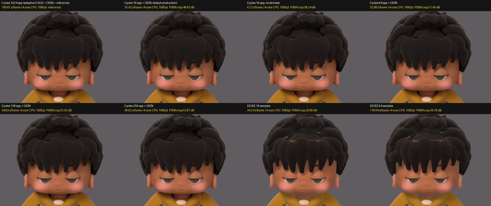

# T-050: GPU / render cost study (no spending)

Date: 2026-11-17 · Branch `t-050-claude-render-cost` · Study only: no purchase, sign-up, paid API or credential was
used. Public prices were read on 2026-11-17 from the pages listed under [Sources](#sources).

## Recommendation

| Use | Setting | Where | Cost |
|---|---|---|---|
| **(a) Daily previews / blocking** | Cycles 640×360, 16 spp, adaptive 0.01, OIDN (today's `run_shot` default) | This kind of CPU container (free to us) | ~2 s/frame (probe); a 10 s shot ≈ 12–30 min |
| **(b) Owner review renders** | Cycles 1080p, 64 spp + OIDN (or 960×540 for quick ones) | Rented RTX 4090, community/interruptible | ≈ $0.01–0.05 per 10 s shot; minutes, not hours |
| **(c) Final episodes** | Cycles 1080p, 128 spp, adaptive 0.01 + OIDN | Rented RTX 4090 (or 5090) by the hour | ≈ $0.84/finished min at 24 fps (range $0.74–3.07 across rates, fps and scene factor); one 2.5 min episode incl. 3 renders/shot ≈ 5 GPU-hours, ≈ $2–8 |

**Monthly estimate** (1 episode/month, 24 fps, 3 renders per shot): finals ≈ $2–7, review renders ≈ $2–6, storage and
idle time ≈ $5–10 (assumption) → **about $10–25/month**; two episodes/month ≈ $20–45. Even with a 3× error in the
GPU-speed estimate below it stays under $100/month.

- **Do not buy a GPU for render cost alone.** A local RTX 5060 Ti 16 GB (≈ $770–790 street price, Nov 2026) renders an
  episode in an estimated ~8 h overnight; it pays for itself only after hundreds of episodes at cloud prices of
  $2–8 per episode. A local card is worth it only if the owner also wants interactive viewport / EEVEE look
  development; if so, take **16 GB VRAM** (RTX 5060 Ti 16 GB) over a 12 GB RTX 5070.
- **Render farms are the most expensive option** here ($3.6–28 per finished minute) and their advantage (many nodes in
  parallel) is not needed at a 5 GPU-hour episode. Keep them as a deadline fallback.
- **EEVEE is not a substitute for Cycles review/final renders** of these characters (systematic look difference, see
  the quality check); use it only for layout/blocking once a GPU is available.
- **Today's CPU final is not viable:** ≈ 200–400 h (8–17 days) of this 4-vCPU container per 2.5 min episode at 24 fps.

## 1. Measured CPU Cycles cost (this container)

Machine: 4 vCPU Intel Xeon @ 2.1 GHz, 15 GB RAM, no GPU. Blender **5.3.0 as the `bpy` module** (Python 3.13, the
repository's `tools/bpy_blender.py` adapter); no Blender binary ran. Cycles device CPU, denoiser OpenImageDenoise,
adaptive sampling on (threshold 0.01, Blender default, as in production), max bounces 12.

**Scene ("probe").** The C++ engine (`plush-render`) is not built here, so the e906 shot could not be baked; a
production shot could not be rendered end to end (same limitation as T-020). Instead
[render_probe.py](render_probe.py) opens the published, read-only boy master (`versions/1.0.0`, never saved), applies
the shared `character_neutral/1` lighting calibration, adds a second instance of the character for a **two-shot
proxy** (as e906) and frames a 16:9, 50 mm camera on both (≈ 75% of frame height, i.e. a medium-close two-shot). The
same still is rendered repeatedly; the steady (second) render is the per-frame cost. Raw reports:
[timings/](timings/c_1080_s128.json).

| Setting (two characters) | s / frame (steady) | Notes |
|---|---:|---|
| 640×360, 16 spp, OIDN (**today's e906 production setting**) | **1.95** | cold first frame 1.99 |
| 1920×1080, 16 spp, no denoise | 6.21 | shows OIDN costs ≈ 9 s/frame at 1080p on CPU |
| 1920×1080, 16 spp, OIDN | 15.4–16.2 | |
| 1920×1080, 64 spp, OIDN | 33.0–34.3 | |
| 1920×1080, 128 spp, OIDN (**proposed final**) | 40.5–44.6 | |
| 1920×1080, 128 spp, OIDN, persistent data | 39.4 (cold 41.8) | −3…−6 %: BVH build is small for a static still |
| 1920×1080, 256 spp, OIDN | 49.6 | adaptive sampling stops most pixels early |
| 1920×1080, 1024 spp, adaptive 0.002, OIDN (reference) | 199.9 | |
| EEVEE 1080p, 16 / 64 samples | 34–40 / 119 | **software OpenGL (Mesa llvmpipe)**: not representative of a GPU |

**Episode extrapolation** (2.5 min, 3 renders per shot → 10,800 frames at 24 fps, 13,500 at 30 fps). Real shots have
a set, props, depth of field and motion blur that the grey-backdrop probe lacks, so the probe time is multiplied by an
assumed **scene factor of 1.5 / 2 / 3** (low / central / high). From [cost_model.py](cost_model.py) →
[cost_model.json](cost_model.json):

| Preset on this CPU | 24 fps episode (h) | 30 fps episode (h) |
|---|---|---|
| Preview 640×360 16 spp | 8.8 / 11.7 / 17.6 | 11.0 / 14.6 / 21.9 |
| Review 1080p 64 spp | 148 / 198 / 297 | 186 / 247 / 371 |
| Final 1080p 128 spp | **201 / 268 / 402** | **251 / 335 / 502** |

## 2. Options: cost per finished minute and turnaround

**GPU speed** is estimated, not measured (no GPU here; opendata.blender.org is blocked by this container's proxy, so
the CPU's own benchmark score could not be run). GPU time per frame = probe final time × scene factor 2 × (CPU score /
GPU OptiX score) + 1 s overhead (scene sync, GPU denoise, PNG write). ASSUMPTION: this 4-vCPU container scores
**50 / 75 / 100** on Blender Open Data (a 16-core Ryzen 9 9950X scores ≈ 660–670 and an 8-core 7700X ≈ 285–297).
GPU scores are Blender Open Data OptiX medians.

| GPU | Open Data OptiX median | est. final s/frame | 2.5 min episode, 24 fps, 3 renders (h) | Street price (new, Nov 2026) |
|---|---:|---:|---:|---:|
| RTX 5060 Ti 16 GB | ≈ 4,146 | 2.1–3.2 | 6.2–9.5 | ≈ $770–790 (MSRP $429) |
| RTX 4070 12 GB | ≈ 5,118 | 1.9–2.7 | 5.6–8.2 | (prev. gen.) |
| RTX 5070 12 GB | ≈ 6,087 | 1.7–2.5 | 5.2–7.4 | ≈ $899–909 (MSRP $549) |
| RTX 4090 24 GB | ≈ 11,534 | 1.4–1.8 | 4.2–5.3 | rental only (see below) |
| RTX 5090 32 GB | ≈ 16,171 | 1.3–1.6 | 3.8–4.7 | ≈ $6,550–6,919 (MSRP $1,999) |

The per-frame overhead dominates on fast GPUs, so the gap between cards is smaller than the benchmark gap; at
these sizes any 12–16 GB card from the list suffices. VRAM: two characters with hair and clothing are small; 16 GB
leaves room for sets and a third character.

| Option | Price (2026-11-17) | $ / finished min, 24 fps | $ / finished min, 30 fps | Episode turnaround |
|---|---|---:|---:|---|
| Rent RTX 4090, community / interruptible (RunPod, Vast.ai) | $0.27–0.34/h | **0.74–0.94** | 0.92–1.17 | ≈ 5 h on one GPU; split across 3–4 GPUs ≈ 1.5 h at the same cost |
| Rent RTX 4090, on-demand secure (RunPod) | $0.69–0.89/h | 1.93–2.46 | 2.41–3.07 | ≈ 5 h |
| GPU render farm (Super Renders, RTX 5090 card-hour) | ≈ $5.17/card-h | 10.3–12.5 | 12.9–15.6 | parallel nodes: < 1 h |
| GPU node rental (iRender 1× RTX 4090) | ≈ $8.20/h | 17.8–22.6 | 22.2–28.3 | ≈ 5 h per node |
| CPU render farm (Super Renders … RebusFarm) | $0.004–0.0141/GHz-h | 3.6–12.7 | 4.5–15.9 | parallel nodes: hours |
| Own GPU (e.g. RTX 5060 Ti 16 GB) | ≈ $780 once + power | ≈ $0.2–0.3 power (ASSUMPTION ≈ 0.35 kW, $0.17–0.30/kWh) | ≈ $0.3–0.4 | ≈ 8 h overnight |
| This CPU container | (free) | — | — | 8–17 days: not viable for finals |

Rental rates include an assumed +30% for boot, upload, idle and interrupted frames. Per-farm GHz-hour definitions
differ, so the CPU-farm row is an order of magnitude only. Prices change often; re-read the live page before any spend.

**Cheaper-settings levers measured here:**

- **Adaptive sampling + OIDN** is already on and is the main lever: 128 → 256 spp costs only +11%, 1024 spp at a
  tighter threshold 4.5×. OIDN on CPU is a fixed ≈ 9 s per 1080p frame; on a GPU node it runs on the GPU (≈ 0.1–0.3 s,
  estimate).
- **Persistent data** saves only 3–6% on a static still here. On animated shots the deformed meshes are rebuilt every
  frame anyway; the useful caching is keeping the Blender process alive per shot (already the case in `shot_render.py`,
  which renders all frames in one process) and keeping GPU kernels/shader caches on a persistent volume of a rented
  instance.
- **EEVEE (Next)** on a real GPU is typically much faster than Cycles, but here it only ran on software OpenGL (slower
  than Cycles CPU), so its GPU speed is not measured. Its look differs (below), so it is a blocking/layout tool only.

## 3. Quality check (8 stills, 1080p, same two-shot)

Crops at 100% of the right character's face and hair. PSNR against the 1024-spp reference (sRGB 8-bit) from
[compare_stills.py](compare_stills.py) → [quality.json](quality.json):

| Still | s/frame (CPU) | PSNR full frame | PSNR face crop | Visual read |
|---|---:|---:|---:|---|
| Cycles 1024 spp, adaptive 0.002, OIDN (reference) | 199.9 | — | — | |
| Cycles 16 spp + OIDN (today) | 15.4 | 53.6 dB | 48.6 dB | very close; slight smoothing of hair-lock edges and cheek blush gradient |
| Cycles 16 spp, no denoise | 6.2 | 44.8 dB | 38.2 dB | visible grain on skin, hair and ears: unusable |
| Cycles 64 spp + OIDN | 33.0 | 56.7 dB | 51.5 dB | indistinguishable from the reference at 100% |
| Cycles 128 spp + OIDN | 44.6 | 57.8 dB | 52.6 dB | indistinguishable |
| Cycles 256 spp + OIDN | 49.6 | 58.2 dB | 52.9 dB | indistinguishable; no gain over 128 |
| EEVEE 16 samples | 34.2* | 37.6 dB | 29.9 dB | different look: flatter skin (no subsurface glow on ears/cheeks), lighter hair shadowing on the forehead, harder hair-lock shading |
| EEVEE 64 samples | 118.9* | 37.6 dB | 29.8 dB | same as 16: the difference is systematic, not noise |

\* software OpenGL. Noise is matched from 64 spp + OIDN upward; 16 spp + OIDN is the cheapest acceptable review
setting, 128 spp is the final setting with margin for darker sets, DOF and motion blur. Full-resolution stills were
kept outside the repository (render budget used: 8 stills plus 8 timing renders).

## Assumptions and limits (not verified)

- The probe is not a production shot: no set, props, DOF, motion blur or animated deformation; covered only by the
  scene factor 1.5–3. A real e906 bake could not run (C++ engine not built in this container).
- The second character is an instance of the boy (the girl has no published master); hair/fur complexity of a girl
  with M4 hair is unknown.
- GPU timings are derived from benchmark ratios and an estimated CPU score (50–100); a ±2× error changes the GPU cost
  per minute by less than 2× because of the fixed 1 s overhead. Validate with one rented-GPU test (owner decision; it
  needs a sign-up and costs < $1).
- Interruptible/spot rentals can be stopped; `run_shot` runs are never overwritten, so a resumed render needs a
  per-frame range re-run. An official Blender-on-cloud runbook (driver, OptiX, asset sync) does not exist yet.
- Prices are from third-party trackers and vendor pages on 2026-11-17; GPU street prices are inflated well above MSRP.

## Files

- [render_probe.py](render_probe.py): the timing/still probe (read-only on the master).
- [compare_stills.py](compare_stills.py): PSNR/MAE and the crop sheet.
- [cost_model.py](cost_model.py) → [cost_model.json](cost_model.json): extrapolation and option costs.
- [timings/](timings/q5_c128_oidn.json): one JSON report per render.

## Sources

Read 2026-11-17.

- Blender Open Data, OptiX query (RTX 5070 median 6,086.86):
  <https://opendata.blender.org/benchmarks/query/?compute_type=OPTIX&compute_type=HIP&blender_version=4.3.0&group_by=device_name>
- Blender 5.x OptiX medians collected 2026-09-12 (RTX 5090 16,171, RTX 4090 11,534; CPU 9950X 671, 7700X 297):
  <https://geturna.com/en/blender-benchmarks>, <https://geturna.com/en/guides/rtx-5090-blender>
- RTX 4070 (5,117.76) and RTX 3060 medians: <https://verdictbits.com/reviews/best-gpu-for-blender-2026/>
- RTX 5060 Ti Cycles score (4,146): <https://www.renderjuice.com/gpus>
- CPU medians (9950X ≈ 659, 7700X ≈ 284.5, Blender 5.2): <https://cpu-compare.com/benchmark/amd>
- GPU street prices: <https://www.tomshardware.com/pc-components/gpus/lowest-gpu-prices-tracking>,
  <https://aliteq.com/rtx-50-series-for-local-ai>, <https://bestvaluegpu.com/history/new-and-used-rtx-5070-price-history-and-specs/>,
  <https://www.tweaktown.com/news/113088/geforce-rtx-5060-ti-16gb-pricing-hits-dollars800-plus-in-the-us-as-memory-crisis-takes-hold/index.html>
- RunPod RTX 4090 rates: <https://www.hivenet.com/post/runpod-pricing-complete-guide-to-gpu-cloud-costs>,
  <https://gpuperhour.com/providers/runpod/rtx-4090>, <https://tech-insider.org/runpod-vs-lambda-vs-vast-ai-2026/>
- Vast.ai RTX 4090 rates (from $0.27/h, median ≈ $0.49): <https://markaicode.com/pricing/vast-ai-pricing/>,
  <https://gpufinder.dev/gpu/rtx-4090>
- Render farms: <https://superrendersfarm.com/pricing>, <https://superrendersfarm.com/article/best-render-farm-blender-2026>,
  <https://render.st/renderstreet-vs-garagefarm/>, <https://www.foxrenderfarm.com/share/best-and-free-blender-render-farm/>,
  <https://www.spheron.network/blog/blender-cloud-rendering-gpu/>
