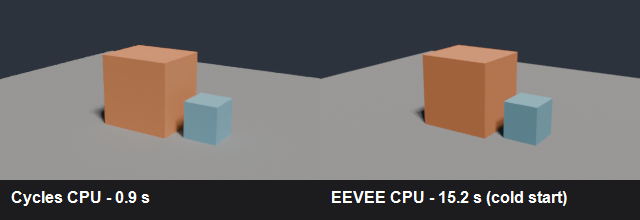

# T-020 — EEVEE draft rendering

Blender 5.3.0 CPU-only validation on 2026-11-16. All rendered dimensions are at most 384 px on their longest edge.
The C++ `plush-render` executable is not built in this checkout, so the production renderer was tested directly with
a one-frame `plush.shot_bake/1` fixture, then through `run_shot.py --stages render` using that existing bake.

## Side-by-side frame

The labeled 320×180 comparison uses the same bake, camera, lights, props, AgX view and eight samples. Cycles rendered
in 0.9 s; EEVEE rendered in 15.2 s. This CPU-only Blender build pays a large cold-start shader/pipeline compilation
cost for EEVEE, so this one-frame timing is not a speed win. The EEVEE result retains the calibrated broad shadow and
contact darkening without bloom.

Source reports: [Cycles](shot_render_cycles.json), [EEVEE](shot_render_eevee.json). Full-entry-point reports:
[run_shot Cycles](run_shot_cycles.json), [run_shot EEVEE](run_shot_eevee.json).

## Cycles compatibility proof

The pre-T-020 `render_swatches.py` was extracted from `HEAD` with `git archive` into ignored `build/T-020/baseline/`.
It and the modified tool, with `--engine` omitted, rendered the same 320×384 fleece frame at eight samples. Both PNGs
have SHA-256:

`71d91ac3b5dd0a34f84e4caa017b2cec2c84f78b1e214b8fbd87cb787ea05155`

This is a byte-for-byte comparison against the pre-change implementation, not merely a visual comparison. The new
shared helper's Cycles branch retains the previous engine, sample and denoising assignments; `run_shot.py` also omits
the renderer flag entirely for the default Cycles invocation.

## Validation

| Check | Result | Evidence |
|---|---|---|
| `run_shot.py --engine cycles|eevee`, default Cycles | PASS | CLI help and both `run_shot_*.json` reports |
| Shared `shot_render.py` selects and reports both engines | PASS | 320×180 direct renders and reports |
| EEVEE soft shadows, AO, bloom off | PASS | `engine_settings` in EEVEE reports; visual comparison |
| Swatch tool supports EEVEE | PASS | [320×384 fleece report](swatch_eevee.json), 42.8 s cold render |
| Turnaround tool supports EEVEE | PASS | [`val27_front` timings](turnaround_eevee_timings.json), 64×128, 2 samples, 21.28 s |
| Omitted-engine Cycles output is byte-identical | PASS | pre-change/current PNG SHA-256 equality above |
| Python syntax and shared-setting assertions | PASS | Blender bundled Python `py_compile`; `test_render_engine.py` |

The Studio command builder now uses `--bake-engine` for the C++ executable, avoiding the new renderer option. Its C++
expectation was updated, but the Studio/C++ test binary was not built in this CPU-only relay environment.
