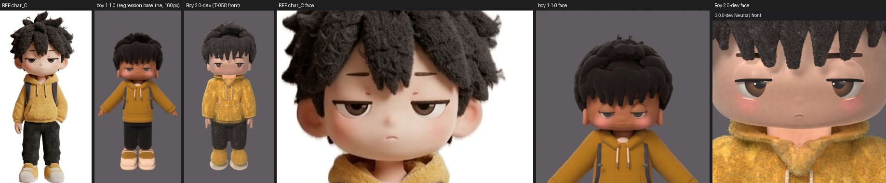
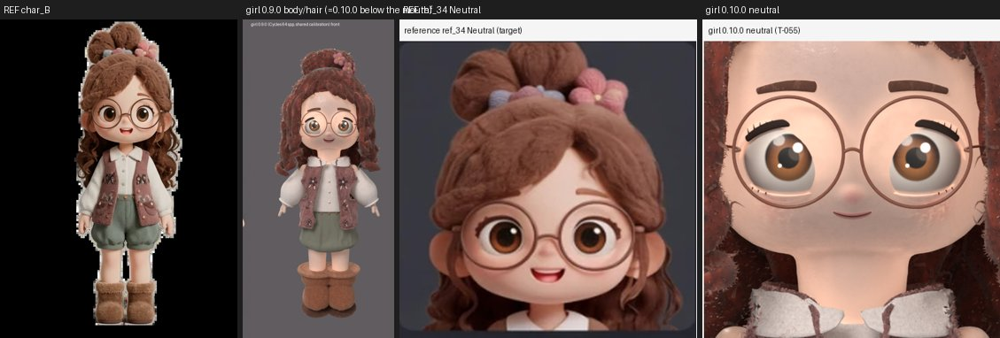

# T-063: visual review against the references: gaps, root causes, plan, third-character readiness

Reviewer: Claude (independent; evaluation and planning only). Branch `t-063-claude-visual-review` from `origin/staging`
(`bbcec62`). Date 2026-11-17. Nothing in code, specs, assets, tools or engine was changed.

**Labels.** **[M]** = measured (a number from a cited file). **[J]** = my visual judgement, made from the cited images
side by side. Grades are judgement. The fidelity scores do not support them well enough on their own (see §5.2).

**Renders: 0 of the 12 allowed.** Current approved versions per `docs/evaluation/characters/fidelity_baseline.json`:
boy **1.1.0** and girl **0.10.0**.
- Boy 1.1.0 is 1.0.0 plus `face.eyes.lid_tracking: 1.0` (`assets/characters/boy_yellow_hoodie/spec/boy_yellow_hoodie.1.1.0.override.json`).
  The rest pose is the same, so the 1.0.0/1.1.0 renders are valid evidence.
- Girl 0.10.0 differs from 0.9.0 only in the mouth rest (`docs/evaluation/characters/T-055/README.md`, "What changed").
  So the 0.9.0 turnaround is valid for body, hair and outfit, and T-055's renders cover the face.
- Boy 2.0-dev has evidence on `t-039-codex-boy2-body`.

No current version was missing evidence, so no new render was needed.

The two composed sheets below are crops of existing images, not new renders:
- [boy_ref_vs_current.jpg](boy_ref_vs_current.jpg): char_C | 1.1.0 | 2.0-dev, body and face.
- [girl_ref_vs_current.jpg](girl_ref_vs_current.jpg): char_B | 0.9.0 body | ref_34 | 0.10.0 face.

---

## 1. Executive summary

Every number in this table is a judgement **[J]**: how close it reads to the reference, in %.

| Area | Boy 1.1.0 (current) | Boy 2.0-dev (T-058) | Girl 0.10.0 (current) | Third char. |
| --- | ---: | ---: | ---: | --- |
| Silhouette / proportions | 60 | 70 | 65 | refs only |
| Face shape | 45 | 45 | 45 | — |
| Eyes / lids / brows | 50 | 55 | 60 | — |
| Mouth / expressions | 45 | 50 | 55 | — |
| Skin | 25 | 45 | 50 | — |
| Hair | 35 | 35 | 30 | — |
| Garments (shape) | 60 | 65 | 55 | — |
| Materials (fuzz/sheen/colour) | 40 | 35 | 50 | — |
| Accessories | 55 (backpack) | 30 (none) | 50 | — |
| Animation / acting | 35 | n/a | 40 | — |
| **Overall** | **≈ 45** | **≈ 50** | **≈ 50** | 0 (not built, by plan) |

Fidelity scores **[M]**:
- boy 64.49 (`docs/evaluation/characters/T-032/boy/fidelity.json`)
- girl 65.41 (`docs/evaluation/integration/consolidation/fidelity/girl/fidelity.json`)
- Boy 2.0-dev: front figure IoU 0.89 (T-058 README)

**Honest headline:** neither character would be mistaken for its reference yet. Proportions and garment layout are
roughly right. What carries the "plush doll" read in the references is still missing:
- soft felted hair;
- the porcelain-peach skin with warm cheeks;
- the round, full-cheeked face with eyes set low;
- matte, dense fleece and felt.

These are **shared-system** gaps (face generator, hair generator, material presets, shot lighting), not per-character
data gaps. Fixing them once will lift all three characters.

**The 5 biggest gaps overall** (impact on the reference read):
1. **Hair (all characters).**
   - Boy: a rounded helmet with a straight-cut fringe, where the reference has spiky felt locks with pointed tips.
     Measured `hair_width_at_eyes` is −71 % **[M]**.
   - Girl: tubular red-brown corkscrew ropes and no fringe, where the reference has soft chestnut felt, a side-swept
     fringe and broad ringlets.
   - In motion, the hair covers the face when the head looks down (T-045 f46).
   - T-044 (running) owns this.
2. **Face construction (shared `face_generic/1`).** The head is long and narrow with a long lower face. Cheeks are not
   full. The lid shells read as pale domes or "goggles" around the eyes. Brows are hard dark bars.
3. **Skin.**
   - Boy 1.x face `skin_face` ΔE00 **21.5**, ΔL **−22.7** **[M]**: much darker and browner than char_C's
     porcelain-peach.
   - Boy 2.0-dev is olive and muddy **[J]**.
   - The girl's face is pale grey-salmon with weak blush (T-026c is still open).
4. **Fleece and felt materials.**
   - Hoodie and trousers fuzz ratio 0.33 / 0.32 **[M]**: flat plastic in 1.x.
   - In 2.0-dev the hoodie fibres read as sparkly orange speckle instead of matte mustard fleece **[J]**.
   - The girl's boots read as smooth leather instead of shaggy fleece **[J]**. Sheen is low on all presets (T-026b).
5. **Acting and expression range.**
   - The boy's brows sit behind the fringe, so Sad, Angry and Bored read almost like Neutral (T-058 expressions).
   - Animation evidence used old versions (T-045, T-046). T-062 fixes that.
   - No hands-in-pockets or slouch posture yet. Wave arcs and spacing are linear (AnimLog critique; T-061 running).

---

## 2. Gap register

Severity: **S1** = breaks identity, **S2** = clearly visible, **S3** = detail.

### 2.1 Boy

References:
- `docs/references/char_C_boy.jpg`, `lineup.webp`
- `assets/characters/boy_yellow_hoodie/references/views/val27_*.png`
- #28 expression tiles (as used in `T-058/expressions.png`)

| # | Area | Gap | Evidence | Sev. | Root cause |
| --- | --- | --- | --- | --- | --- |
| B1 | Hair | 1.x: dense rounded helmet; fringe a straight band of clumps. Reference: long spiky felt locks, pointed tips, crown tufts, ragged outline. Back: a puffball instead of downward-pointing locks | `hair_width_at_eyes` −0.706, hair IoU 0.785 (looks fine; misleading) **[M]**; T-049 boy contact sheet; this folder's boy sheet **[J]** | S1 | `hair_clumps/1` (legacy clump generator) and its frozen ellipsoid; 2.0-dev pins the same hair (T-058 §2 "Hair"). Covered by **T-044** |
| B2 | Face shape | 2.0-dev: wide, boxy face with a long lower face; mouth sits far below the eyes; neck long and visible. Reference: round, wide-cheeked, short lower face, chin small | T-058 face_closeup / expressions **[J]**; 1.1.0 `chin` landmark error 0.095 head, `leg_gap` −36 % **[M]** | S1 | T-039 body head loft (`head.profile_levels`) plus `face_generic/1` placement; no cheek-volume parameter. T-058 lists it (diff. 3) but no task owns it |
| B3 | Lids | Lid shells read as pale domes around the eyes, strongest in Happy and Bored; the reference shows only a soft crease. Lower lid / lash line missing | T-058 face_closeup, expressions; T-058 diff. 2 **[J]** | S2 | `face_generic/1` lid shells: a separate spherical shell with its own material, not blended into the skin. Shared: the girl shows it too ("goggle" shading inside the glasses, T-055 front sheet) |
| B4 | Brows | Brows are thin, hard black bars. In 2.0-dev 3/4 they draw across the fringe clumps. Brow acting is hidden by the fringe | T-058 face_closeup (3/4) and expressions **[J]**; brow keys move 7–11 mm **[M]** (T-058) | S2 | Fringe length (B1) plus brow material/shape in `face_generic/1` (flat curve, no taper); brow-to-hair depth not managed (keep-out) |
| B5 | Eyes size | Eyes too small and too close together | `eye_width_to_head` −23.6 %, `eye_area_to_head` −41 %, `eye_spacing` −12.5 % **[M]** (1.1.0) | S2 | 1.x spec values; 2.0-dev improves the iris (larger, dark brown) but was not re-measured |
| B6 | Skin | 1.x face much darker and browner than the reference; 2.0-dev olive and muddy. Reference: pale peach, glowing, strong rosy cheeks | `skin_face` ΔE00 21.46, ΔL −22.7, ΔC +12.5 **[M]**; T-045 sheet; T-058 face **[J]** | S1 | Skin colour in spec plus the skin-felt preset under the shared calibration (`character_neutral/1`); no SSS-like warm glow; face/limb mismatch (`skin_limbs` ΔE 6.3) |
| B7 | Expressions | Sad, Angry and Bored read close to Neutral; Happy shows black arcs on pale domes. Reference: strongly angled short brows, soft closed eyes | T-058 expressions.png **[J]** | S2 | B3 + B4; 1.0.0 package exports only Blink/Smile/JawOpen/BrowDown (T-046 README, line 183). 2.0-dev adds split AUs and pout (good), but the per-side and pout channels are not yet in `content/emotions/face_motion.json` (T-058 "Controls") |
| B8 | Hoodie material | 1.x: smooth, plastic-looking, darker mustard; 2.0-dev: sparkly orange speckled fibres. Reference: dense matte mustard fleece | hoodie ΔE00 14.45, ΔL −15.7, fuzz 0.33 **[M]** (1.1.0); T-058 strip **[J]** | S1 | `presets/1` fleece/fibre settings: fibre colour/brightness variance too high, no density/matting; T-026a/b open. Missing presets "rib knit", "suede", "cord" (T-058 list) |
| B9 | Hoodie shape | 2.0-dev: hood bag flat from the back (reference: big hood); weak pocket; **underarm skin gap** visible in front, 3/4 and back-3/4 | T-058 strip **[J]**; T-058 diff. 4–5 | S2 | `garment/1` hoodie v1 (T-058) hood volume parameters; underarm gap = garment fit vs body at the armpit (shared fit/clearance) |
| B10 | Shoes | 2.0-dev: round blobs on a separate disc sole. 1.1.0 reads closer. Reference: low chunky sneaker, cream toe cap, laces, white stripe | T-058 strip; 1.1.0 baseline **[J]**; shoes area ratio 1.36 **[M]** | S2 | `body_generic` ellipsoid foot; no sneaker garment type (shoes type has no toe cap/laces/stripe parts) |
| B11 | Trousers | Joggers slightly narrow and short in 1.x; reference: loose, bunched at the ankle over the shoe | `hem_trousers` −3.6 %, trousers area 0.725 **[M]** | S3 | spec ease; `drape` not applied |
| B12 | Backpack | 2.0-dev has none; 1.x has a rigid box | T-058 diff. 8; backpack IoU 0.176 **[M]** | S2 | no shared backpack accessory type (1.x one is legacy code) |
| B13 | Arms / pose | Arms 20 % short; no hands-in-pockets pose; no slouch | `arm_length` −20.3 % **[M]**; T-045 sheet **[J]** | S2 | Body arm length in spec; pocket pose needs T-047 collision + T-051 fingers; slouch = T-053 profile (draft only) |

### 2.2 Girl

References:
- `docs/references/char_B_brown_hair.webp`, `lineup.webp`
- `assets/characters/girl_auburn_bun_glasses/references/uploads/ref_30.webp`–`ref_42.webp`
- `views/sheet30_*`

| # | Area | Gap | Evidence | Sev. | Root cause |
| --- | --- | --- | --- | --- | --- |
| G1 | Hair structure | Tubular corkscrew ringlets everywhere, thin and wiry; reads as dreadlocks. Reference: soft felted crown, broad ringlets only below the ears, felt texture | consolidation turnaround (0.9.0 = 0.10.0 hair); T-049 girl sheet **[J]**; hair fuzz ratio 0.52 **[M]** | S1 | `groom/1` yarn lock style + felt finish; T-049 "visual match 2/3" for A/B. **T-044** |
| G2 | Fringe / forehead | **No fringe:** a bare, high forehead. Reference (char_B, ref_34): side-swept fringe covering the upper forehead, locks framing the cheeks | T-055 front sheet; this folder's girl sheet **[J]**; `hairline` dy −0.045 head **[M]** | S1 | Groom spec has no fringe volume; `felt_volume fringe` exists but is not used for her. **T-044** (AC 2 names it) |
| G3 | Hair colour | Red/auburn; reference is warm chestnut/milk-chocolate brown | hair ΔE00 2.04 **[M]** (small: masks/lighting average it); visually clearly redder **[J]** | S2 | Colour target plus felt-hair preset; note the colour metric under-reports (see §5.2) |
| G4 | Bun | Small bun with a grey ring; reference: big fuzzy two-lobed bun, blue/pink flower clips | turnarounds **[J]**; hair-accessory ΔE00 20.6, IoU 0.15 **[M]** | S2 | groom bun size/lumps spec; flower colour/arrangement data |
| G5 | Face shape | Long rectangular head, long lower face, flat sides; reference: round, full cheeks, small chin | T-055 front sheet **[J]**; `chin` dx −0.046 **[M]** | S1 | `face_generic/1` + body head shape; same root as B2 |
| G6 | Eyes / lids | Grey lid-shell shading under the glasses makes "goggle" eyes; eyes 18.5 % narrow, 13 % close together | T-055 front **[J]**; `eye_width` −18.5 %, `eye_spacing` −13.1 % **[M]** | S2 | B3 root (lid shells) + spec values |
| G7 | Brows | Thick, dark, flat bars; reference: thin, light brown arcs, partly under the fringe | T-055 front **[J]** | S2 | brow shape/colour spec + B4 shared brow rendering |
| G8 | Nose | Prominent pink bulb with a specular highlight; reference: tiny soft nose | T-055 front **[J]** | S3 | nose size/material in spec (skin sheen on the nose) |
| G9 | Mouth / cheeks | Neutral mouth narrower and thinner than ref_34; cheeks not lifted at rest; Happy open smile smaller than ref_30 | T-055 "Deviations" 1–3 **[J]**; T-055 corner lift 4.2 mm **[M]** | S2 | `face_generic/1`: `closed_smile` ignores `rest_mix`, no `soft_smile` rest (T-055 limitation 1). Queued in **T-059** |
| G10 | Skin | Face pale and grey-salmon, weak blush; neck/face lighter than in the reference | T-026c open; T-046 render **[J]**; skin_face ΔE00 3.5 **[M]** (small numerically) | S2 | skin-felt preset + face shader vs body (T-026c) |
| G11 | Vest | Vest narrower; embroidery reads as dark dots; reference: mauve felt, folk embroidery, pockets, buttons | vest IoU 0.158, area 0.287 **[M]** (partly a mask artefact, §5.2); turnaround **[J]** | S2 | `garment/1` vest options; no embroidery/appliqué decal system |
| G12 | Boots | Smooth, shiny, tall leather-like boots with a lining ring; reference: shaggy fleece | turnaround **[J]**; T-026a/d open; boots IoU 0.066 **[M]** is a **segmentation artefact** (render 509 px vs ref 5235 px though boots are visible; `per_view` in the girl fidelity.json) | S2 | `boot fleece` preset fuzz below target (T-026a); lining ring geometry (T-026d) |
| G13 | Proportions | Arms 26 % short; figure 17 % narrow; shoulders 12.5 % narrow; legs look long and thin | `arm_length` −26.1 %, `figure_width` −16.8 %, `shoulder_width` −12.5 % **[M]** | S2 | body spec values; queued in **T-059** (proportions) |
| G14 | Glasses | Close; frame slightly thin/pale vs reference copper | glasses IoU 0.44 **[M]**; **[J]** | S3 | accessory material |
| G15 | Acting | Waves hidden by hair; looking down puts the hair over the face; profile behaviours (hand-to-chin, pointing) not yet in shots | T-045 sheet f46, f90 **[J]**; T-045 report flags | S2 | hair collision/keep-out (T-044/T-047); T-053 profiles not merged |

### 2.3 Animation (both)

| # | Gap | Evidence | Sev. | Root cause / owner |
| --- | --- | --- | --- | --- |
| A1 | Evidence used old versions (boy 1.0.0, girl m3/0.9.0), so the combined current quality was never seen | T-045 README ("boy published 1.0.0, girl …"); T-046 README l.107 | S2 (process) | No "current" cast (**T-062** running). The T-062 proof label reads "girl 0.9.0 via cast current" (`old_vs_current_f90.png` on its branch) although the baseline is 0.10.0: **verify before merging T-062** |
| A2 | Linear spacing on wave lift; straight wrist paths; no overlap on strings/hair | AnimLog critique, verified (T-061 "Why") | S2 | clip-layer blend + linear retime (**T-061**) |
| A3 | Boy reads stiff and upright, not slouched; no hands in pockets; no long stares / small fidgets in a shot | T-045 sheet vs char_C **[J]**; checklist items (`REVIEW_CHECKLIST.md` boy) | S2 | T-053 profiles not built (draft only); pocket pose needs T-047 + T-051 |
| A4 | Facial acting weak on the boy: brows hidden, few controls in the 1.x package | T-046 README l.183 | S2 | B4/B7; 2.0-dev controls need channels in `face_motion.json` |
| A5 | Lip sync | not started in the engine; toolchain T-054a running | S3 now | **T-054a** (tools) + later engine task |
| A6 | Hair/arm/prop collisions (wave hidden by hair, arm clearance) | T-045 flags; T-040r1 blocked | S2 | **T-047** queued |

### 2.4 Third character (references only: `assets/characters/girl_white_hair_blue_dress/references/uploads/01–15`)

Not built (correct per roadmap). I checked T-057's gap list against `15_canonical_identity_production_checklist` and the
T-057 contact sheet **[J]**. I agree with its verdicts. Her hardest features fall on the **same weak systems** as above:
- felt hair with a fibre halo: 2 pom-pom buns, a full clumped fringe, waist-length soft S-waves;
- a round, full-cheeked face with very large eyes (an extra risk given the lid-shell issue B3);
- dense knit and fleece materials: cable-knit skirt, shaggy boots.

Additions to T-057's list:
1. **The lid-shell look (B3) is a bigger risk for her than for the others.** Her eyes are much larger and glossier, so
   pale domes would be very visible.
2. **Her skin is the palest of the three.** The skin preset must reach porcelain-peach with strong blush (her `w01`).
   Today neither existing character does.

---

## 3. Improvement plan (prioritised by visual impact ÷ effort)

Not duplicated, because already covered:
- **T-044**: hair v3 for all three, incl. fringe, keep-out, buns, felt halo, presets for hair.
- **T-058**: Boy 2.0 body, face controls, hoodie.
- **T-061**: spacing, arcs, accessory chains.
- **T-062**: current cast.
- **T-054a**: lip-sync tools.
- **T-060**: Windows CI.
- **T-059** (queued): girl mouth, cheeks, skin, eyes, proportions, vest, boots, ears, accessories.
- **T-047** (queued): collisions.

| P | Proposed task | Kind | Fixes | Impact / effort | Depends on |
| --- | --- | --- | --- | --- | --- |
| **P1** | **Face v2 construction (`face_generic/2`, opt-in):** (a) lids blended into the skin (shared skin material, soft crease shading, a lower lid/lash line), not separate pale shells; (b) cheek volume / round face parameters (cheek fullness, lower-face length, chin size) on the head loft; (c) brows as tapered strokes with a hair keep-out depth; (d) `soft_smile` rest that honours `rest_mix`; (e) sided mouth corners + pucker (already partly in T-058's split AUs: reuse, don't redo) | shared | B2, B3, B4, B7, G5, G6, G7, G9; third char. eyes/pucker | **very high / M–L** | T-058 merged (split AUs, pout); coordinate with T-059 (it lists cheeks/mouth: make T-059 *consume* face v2 rather than implement it) |
| **P2** | **Skin look round (`presets/2` skin-felt):** porcelain-peach base, warm SSS-like glow, stronger cheek blush, same shader on face and limbs; calibrate to the three characters' colour targets under `character_neutral/1` | shared + spec colours | B6, G10, T-026c; third char. | **very high / S** | none (can run now; it touches `presets.json`, held by T-044: run after T-044 or as a file-claim split) |
| **P3** | **Fleece/felt/knit material round (`presets/2`):** matte, dense fleece (low fibre colour variance, matted short fibres), shaggy boot fleece, rib knit, cord, suede, cream sole, cable-knit relief; resolve T-026a/b (sheen metric vs light) | shared | B8, G12, T-026a/b/d; third char. cable knit and boots | **high / M** | after T-044 (presets file); T-026b needs a decision on metric vs light first |
| **P4** | **Garment detail types:** sneaker shoe type (toe cap, laces, stripe, sole); backpack accessory type with straps (spring chains via T-061); hoodie hood volume + underarm fit fix; gathered/pleated skirt + hem rib (third char.); embroidery/appliqué decals (girl vest) | shared | B9, B10, B12, G11; third char. skirt | high / M–L | T-058 merged; T-061 for strap chains |
| **P5** | **Proportion pass via spec, boy 2.0 and girl:** arm length (+20–26 %), eye size/spacing, shoulder/figure width, lower-face length (with P1) | per-character data | B5, B13, G13 | medium-high / S | P1 (face params); girl part is already in T-059 |
| **P6** | **Fidelity tool fixes (measurement trust):** region segmentation on renders (boots 509 vs 5235 px, vest 0.29 area); weight the hair score so that a visually better hair (T-049 C) does not drop the score by 8 points; add a skin-colour and face-window metric | shared tool | §5.2 | medium / S | before T-044 / P1 acceptance, so the gate does not "FAIL" improvements |
| **P7** | **Acting round (after T-053, T-047, T-051):** boy slouch, hands in pockets, long stares; girl hand-to-chin, pointing; per-side/pout channels into `face_motion.json` | shared engine + profiles | A3, A4, B13 | high / M | T-053 profile system, T-047, T-051, T-058 controls |

**Order:**
1. **Now:** T-044, T-058 and T-062 finish. Run **P6** next: small, and it prevents false regressions.
2. **Next:** **P2**, then **P3**, after T-044 releases `presets.json`. Then **P1** (face v2).
3. **Then:** T-059 for the girl and the Boy 2.0 look round, both built on P1–P3 plus P5.
4. **After that:** P4 and P7.

**Main reordering advice: run P1 (face v2) before T-059.** Otherwise T-059 tunes girl data on a face generator that
cannot produce the reference cheeks or lids, and the work would be redone.

---

## 4. Third character readiness

Roadmap Priority v5, phase 5 readiness criteria (`docs/ROADMAP.md`):

| Criterion | State on `origin/staging` | Met? |
| --- | --- | --- |
| T-041 unchanged-character guard | in main | ✅ |
| T-043 spec versions | in main | ✅ |
| Hair v3 | T-044 running; no branch pushed yet | ❌ |
| Garment types | `garment/1` + hoodie (T-058, not merged); skirt gathers, cable knit, tights, legwear missing (T-057 gaps) | ❌ partial |
| T-053 profiles | T-053a drafts only; profile system not built | ❌ |
| Boy and girl approved | girl 0.10.0 intermediate only; boy 2.0 not approved | ❌ |

**Assessment:** 2 of 6 criteria met. Her look depends on hair, face construction, skin and knit/fleece materials, the
four weakest systems today (§1). Building her now would bake today's gaps into a third spec and triple the rework.

**Recommended start point (a condition, not a date): start V6 build when all of these hold:**
1. **Hair v3 (T-044)** is merged and the owner has approved it on boy and girl. Her pom-pom buns and fringe build as
   T-044 head-only tests.
2. **Face v2 (P1)** and **skin `presets/2` (P2)** are merged and approved on at least one character.
3. **Knit and fleece presets (P3)** are merged, plus the **skirt gathers + hem rib** of P4.
4. **The T-053 profile reader** exists, so her goofy/bubbly draft profile can be applied.
5. **Boy 2.0 and the girl's next version** are owner-approved as "reference-close". They don't need to be final, but
   all their S1 gaps must be closed.

**Can be prepared in parallel now (no shared files, no visual risk):**
- **Her spec skeleton as data only** under her asset folder: body proportions from `measurements.json`, colour
  targets, outfit layout, pinned to *future* generator versions; not built.
- **Fidelity annotations for her references:** region hints, landmarks, masks for the `w02` views. P6 benefits from them.
- **Her personality profile review** against T-053a's schema (`content/personality/girl_white_hair_blue_dress.draft.json`).
- **Test fixtures:**
  - her hair as a T-044 head-only candidate (already in T-044 AC 4);
  - a synthetic "very large eyes" config for the face v2 tests (P1);
  - a skirt-gathers test on the existing girl body (P4).
- **Owner questions from T-057** (3 open) answered before the build.

---

## 5. Process observations

1. **Old versions in evaluations.** This hid the combined quality (A1). T-062 fixes it.
   - Check: the T-062 proof's label says girl **0.9.0** via `"current"`. Either the branch's baseline predates the
     0.10.0 pin bump (ca460a2), or the resolver reads the wrong field. Re-verify after `git merge origin/staging`.
2. **The fidelity score is not a safe acceptance signal for look changes. [M]**
   - T-049 approach C (judged best, 4/5) scores **56.22 vs 64.49** for the current boy helmet hair (`T-049/scorecard_table.md`).
   - Boots and vest region IoUs are segmentation artefacts (§2.2 G12).
   - The skin_face ΔE00 of the girl (3.5) does not reflect the visible grey cast.
   - With the "drop > 2.0 = FAIL" policy (`fidelity_baseline.json`), real improvements will trip the gate. Owner
     review side by side must remain the deciding step, and P6 should come early.
3. **Per-character tuning on a generator that cannot reach the target.**
   - T-055 hit the limit of `closed_smile` (no cheek lift).
   - T-058 hit lid shells, fringe and missing presets.
   - Each such task records the limit honestly, but the shared fix has no owner. Recommendation: when a task's
     "limitations" names a generator limit, open the shared-system task immediately (P1 collects today's).
4. **`presets.json` is a single hot file.** T-044 holds it, and T-058 had to leave its material problems unfixed
   because of it. P2 and P3 will queue behind T-044. Splitting presets into per-family parts (as T-043 did for specs)
   would let material work run in parallel.
5. **Evidence resolution.** Regression baseline images are 160×320 (turn views). That is fine for a pixel guard but
   too small for visual review. Keep owner-review sheets at ≥ 512 px (as T-055 and T-058 did).

## Sources consulted

- Process:
  - `docs/process/IMPLEMENTER_PROMPT.md`, `docs/process/OWNER_DECISIONS.md`, `docs/ROADMAP.md`,
    `docs/process/TASK_LOG.md`
  - `docs/tasks/T-044.md`, `T-054a.md`, `T-060.md`, `T-061.md`, `T-062.md`, `T-063.md`
- Character docs:
  - `docs/characters/REVIEW_CHECKLIST.md`
  - `docs/characters/girl_white_hair_blue_dress/SYSTEM_GAPS.md`
- Fidelity:
  - `docs/evaluation/characters/fidelity_baseline.json`
  - `docs/evaluation/characters/T-032/boy/fidelity.json`
  - `docs/evaluation/integration/consolidation/fidelity/girl/fidelity.json`
- Evidence on `staging`:
  - `docs/evaluation/characters/T-049/`, `T-055/`, `T-057/`
  - `docs/evaluation/animation/T-045/`, `T-046/`
  - `docs/evaluation/integration/consolidation/`
  - `docs/evaluation/regression/baselines/`
- Evidence on other branches:
  - `t-039-codex-boy2-body`: `docs/evaluation/characters/T-058/` (README, turnaround_strip, face_closeup, expressions)
  - `t-062-claude-current-cast`: `docs/evaluation/animation/T-062/old_vs_current_f90.png`
- References:
  - `docs/references/char_C_boy.jpg`, `char_B_brown_hair.webp`, `lineup.webp`
  - `assets/characters/girl_white_hair_blue_dress/references/uploads/15_canonical_identity_production_checklist.webp`
- T-044 (hair v3): no branch pushed at review time, so there was no in-progress evidence to review.
