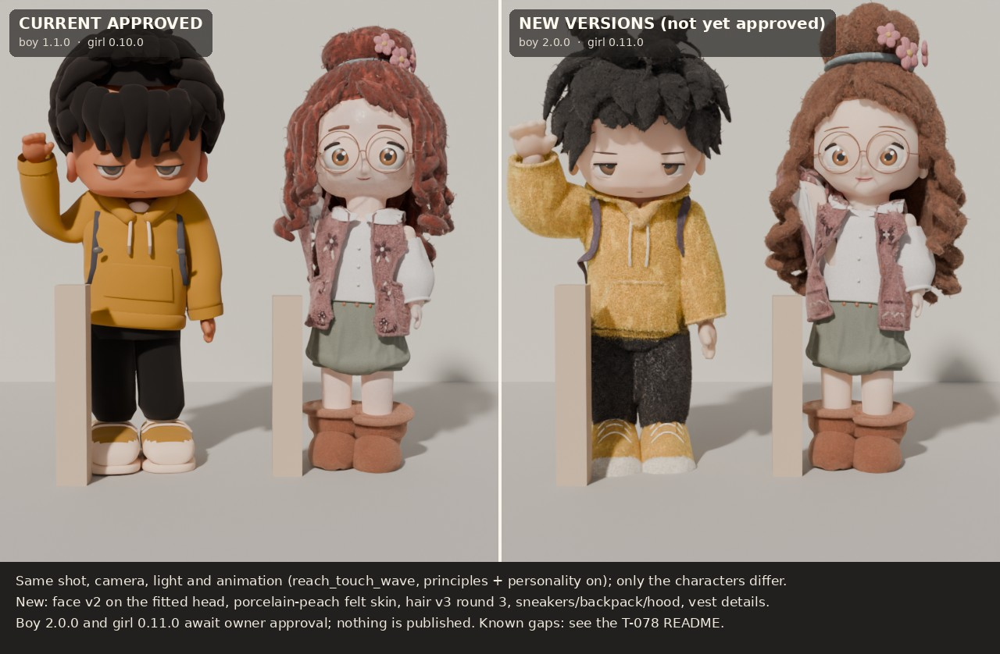

# T-078: progress video — current approved | new versions

Implementer: Claude (cloud) · evaluation, evidence only · branch `t-078-claude-progress-video` (from `origin/staging`).
No system, spec, preset or published version was changed. Blender: **bpy 5.3.0 module** (Python 3.13) through
`tools/bpy_blender.py` (no Blender binary in the container); engine: `plush-render` built from this branch.

## Result

- **Video:** [T-078_progress_current_vs_new.mp4](T-078_progress_current_vs_new.mp4) — 1280×720, 24 fps, H.264,
  5.0 s (shot frames 13–132). Left: **current approved** (boy 1.1.0 · girl 0.10.0). Right: **new versions**
  (boy 2.0.0 · girl 0.11.0, not yet approved).
- **Still sheet:** [T-078_still_sheet.jpg](T-078_still_sheet.jpg) (frame __STILL__, 1280×838 JPEG) with the caption.



**Caption (3 lines)**
1. Same shot, camera, light and animation (reach_touch_wave, principles + personality on); only the characters differ.
2. New: face v2 on the fitted head, porcelain-peach felt skin, hair v3 round 3, sneakers/backpack/hood, vest details.
3. Boy 2.0.0 and girl 0.11.0 await owner approval; nothing is published.

## What is combined (right side)

The Supervisor relayed an owner decision during the task (2026-11-18): the right side must show the **actual latest
versions** instead of the task's candidate-override stack. So it uses:

| Character | Source | Contains |
| --- | --- | --- |
| boy 2.0.0 | `boy_yellow_hoodie.2.0.0.spec.json` at `t-080-claude-boy-2-0-0@39aa35c` (T-080) | 2.0 dev base, face v2 + fitted head (T-065), skin-felt/2 (T-066), hair v3 round 3 (T-079), sneakers/backpack/hood fix (T-068) |
| girl 0.11.0 | `girl_auburn_bun_glasses.0.11.0.spec.json` at `t-081-claude-girl-0-11-0@9f20c2d` (T-081) | 0.10.0 base, face v2 + fitted head, skin-felt/2, hair v3 round 3, vest details, neck on the collar |

Both masters were built with `pipeline/charsys/build_character.py` from a worktree at the named commit (T-080/T-081
code changes, e.g. `versions.py` presets/2, `face_features.py`, are needed). The shot was then run from a **local,
unpushed** merge of this branch + those two commits; the specs exist only on those branches, so
`test_run_shot_current.py` fails on this branch until T-080/T-081 merge (expected, per the Supervisor).

Left side: cast `"current"` (resolved by run_shot from `fidelity_baseline.json`): published boy 1.1.0, girl 0.10.0.

**Third character:** left out. She has no spec of her own (T-044 stand-in body), and the owner decision limits the
video to the latest versions of the boy and girl.

**Earlier candidate stack (superseded, kept for traceability):** before the owner decision I built the task's
combined overrides (`candidates/`: boy 2.0.0-dev + T-065 + T-068 + T-066 restated for the generic path; hair v3
round 2 via T-070's post-build tool). They rendered correctly (11 frames, not used), and surfaced one bug: see Gaps 1.

## Shot and render settings

- Shot: `content/scenes/eval/reach_touch_wave` copied to `shot_current/` and `shot_new/`; only the cast, a
  character-level `personality` (T-053 profiles) and the camera lens differ from the source. Animation principles
  (T-061) are on (default). 24 fps, frames 13–132 (reach + touch + wave).
- Camera: same position/target as the source; **640×720 portrait panel with focalMm 58** (≈ a centre crop of a
  1280×720 render of the source 35 mm camera, slightly wider), identical on both sides. Light: the shot's own
  (rect + sun + sky), identical.
- Cycles CPU (4 cores), **16 spp + OIDN** (run_shot's review settings), every **2nd frame** rendered and held
  (60 renders per side) — the task's budget option. `tools/render_step.py` renders the run_shot `shot.blend`
  (run_shot has no frame step).
- Time per frame: current ≈ __TCUR__ s, new ≈ __TNEW__ s (wall clock, 640×720).
- Composite: `tools/compose.py` (labels, divider, ffmpeg libx264 CRF 18).

## Known gaps (honest list)

1. **Hair v3 stale vertex weights (post-build path).** T-070's `build_candidate.py` builds `scalp_cap` from the head
   mesh and keeps the head's vertex-weight indices; on generic-path heads `export_engine.py` then fails
   (`IndexError` in `eye_pivots`). Worked around for the superseded candidates only, with
   `tools/clean_stale_weights.py` (in-folder). The final 2.0.0 / 0.11.0 builds do not show it (normal build path);
   the shared fix is T-079.
2. __VISUAL_GAPS__
3. Every 2nd frame is held, so motion is 12 renders/s inside a 24 fps video (slight stepping on fast arm moves).
4. Right-side specs are not on staging yet (see above); the shot file pins them with a `legacy_reason`.

## Files

| Path | Purpose |
| --- | --- |
| `shot_current/shot.scene.json`, `shot_new/shot.scene.json` | the two shots (same everything except cast) |
| `tools/render_step.py` | render every Nth frame of a run_shot `shot.blend` |
| `tools/compose.py` | side-by-side frames, MP4 and still sheet |
| `tools/clean_stale_weights.py` | evaluation-only fix for Gap 1 (candidate stack) |
| `candidates/*.json` | superseded candidate stack (boy skin restated for the generic path; boy hair r2 head object) |
| `T-078_progress_current_vs_new.mp4`, `T-078_still_sheet.jpg` | deliverables |

## Reproduce

```sh
B=<bpy 5.3 wrapper>
# masters (in worktrees at the named commits)
$B -b --factory-startup -P pipeline/charsys/build_character.py -- --spec <2.0.0 or 0.11.0 spec> --out <dir> --no-glb --no-compare
# shots (new side from a merge of this branch + 39aa35c + 9f20c2d; masters placed in run_shot's build cache)
python3 pipeline/production/run_shot.py --shot docs/evaluation/showcase/T-078/shot_<side>/shot.scene.json --blender $B --stages prepare,bake --frames 13-132
python3 pipeline/production/run_shot.py --shot ... --blender $B --stages render --frames 13-132 --blend-only
$B -b --factory-startup -P docs/evaluation/showcase/T-078/tools/render_step.py -- <shot.blend> <frames dir> 13 132 2
python3 docs/evaluation/showcase/T-078/tools/compose.py <current frames> <new frames> <work> docs/evaluation/showcase/T-078 --still <n>
```

Token usage: not available. Repeated work: 11 right-side frames of the superseded candidate stack, one test frame per
cast configuration (3), and the blend-only step run three times.
