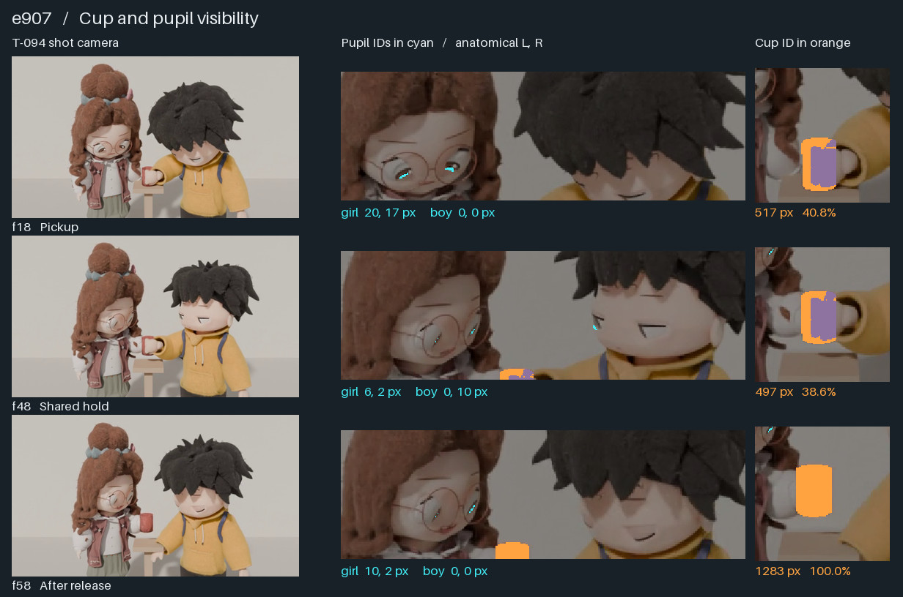

# T-123 · Shot-camera readability on e907

**At the shared hold (f48), the largest visible cup patch covers 497 of 1,286 px (38.6%).** The girl’s pupils measure 6 px left and 2 px right. After release (f58), all 1,283 projected cup pixels form one visible patch. The minimum is 179 px (14.1%) at f15. The cup falls below 40% on 24 of 66 frames, f12–17 and f36–53.

[Per-frame CSV](readability.csv) · [Minima and frames below threshold](summary.txt) · [Evidence JPEG](evidence.jpg)

## Reading the measurements

Each CSV row is one episode frame at 640 × 360. `cup_patch_px` counts pixels in the largest **8-connected** visible cup patch. `cup_only_px` counts the entire projected cup inside the frame, from a second pass with all occluders hidden. `cup_patch_pct` is 100 times the first count divided by the second. A fully occluded cup measures 0%. An empty in-frame silhouette leaves the percentage blank and gets its own frame list in the summary. T-116 used a red-colour selection in the movie and compared the hold to release. The denominator here follows the pose and camera on each frame.

Each pupil column counts **all** visible pixels in that character’s anatomical left or right pupil. Both masters paint their pupils on the eyeball. The mask uses the front half of the eye and the midpoint of its authored soft pupil edge, including the girl's round-iris scale correction. The acrylic lens is treated as clear. The glasses frame, lids, lashes, fringe and hands still occlude. These geometric counts include the pupil surface beneath painted catchlights. Lighting, contrast, lens reflections and refraction can affect how easily a viewer reads those pixels. [Felt eye shader](../../../../pipeline/charsys/face_v3/felt_eye.py)

The worked example uses review thresholds of **40%** for the cup patch and **8 px** for each pupil. Values equal to a threshold pass that comparison. The figures are review choices at this resolution. The summary lists all frames strictly below each threshold and all frames tied for each minimum.



The left column shows the published T-094 movie. The two detail columns overlay the new masks on the same movie frame. Cyan marks visible pupils, orange marks all visible cup pixels, and muted purple fills the occluded part of the cup silhouette. The number below the cup counts only the largest orange patch. [T-094 shot and cast](../../characters/T-094/exchange/README.md) · [T-116 hand measurements](../../../audit/current_review/REVIEW.md)

## Run on existing ID passes

The standalone analyzer needs Python, NumPy and Pillow. Supply lossless, single-channel byte IDs (grayscale or palette indices) with the same frame number, dimensions, camera and sampling in both passes. Put them in `visible/frame_####.png` and `cup_only/frame_####.png` below the mask directory. Reserve 0 for background and use one unique ID for the cup and each named pupil. The isolated pass contains only background and the cup ID. A zero pupil count means that label has no visible pixels, so verify label assignments at the mask source. Missing frames or inconsistent silhouettes stop the analysis.

Run the following from the repository root in PowerShell. With existing passes, skip to **Generate the report** and supply the shot’s frame range, IDs and thresholds.

```powershell
$py = 'C:/AnimationWT/t106-codex/build/perf-venv/Scripts/python.exe'
$evidence = 'docs/evaluation/tools/T-123'
$masks = 'build/T-123/masks'
New-Item -ItemType Directory -Force build/T-123/tmp | Out-Null
$env:TEMP = (Resolve-Path build/T-123/tmp).Path
$env:TMP = $env:TEMP
$env:PYTHONDONTWRITEBYTECODE = '1'
```

## Reproduce the e907 masks

Input revision `1e3ea34`, e907 s010, frames 1–66 at 24 fps, boy 2.1.0 and girl 0.12.0. The scratch shot is a byte-for-byte copy of T-094's pinned scene. The production shot builder reports the girl's two corrective reach morphs as unmapped. These counts use the pose it reconstructed. An existing animated `shot.blend` and matching `cast.json` can be used directly in the Blender mask command. On this worktree the interrupted build already held the configured Ninja directory and the boy’s exported engine package. Only the animation bake needs `plush-render`. Blender 5.3 renders both masks with one Cycles sample, Raw output, a box filter, fixed seed and no denoising, motion blur or depth of field.

Set the PowerShell variables above, then prepare the bake executable and shot beneath `build/T-123`. The configure command also works with the cached build directory.

```powershell
$work = 'build/T-123'
$blender = 'D:/Animation/tools/blender-5.3/blender.exe'
$source = 'docs/evaluation/characters/T-094/exchange'
$shot = "$work/e907/shot.scene.json"
$run = "$work/e907/build"
New-Item -ItemType Directory -Force "$work/e907" | Out-Null
Copy-Item "$source/shot.scene.json" $shot

cmd /c 'call C:\BuildTools\Common7\Tools\VsDevCmd.bat -no_logo -arch=x64 && C:\BuildTools\Common7\IDE\CommonExtensions\Microsoft\CMake\CMake\bin\cmake.exe -S . -B build/T-123/engine -G Ninja -DCMAKE_BUILD_TYPE=Release -DCMAKE_MAKE_PROGRAM=C:/BuildTools/Common7/IDE/CommonExtensions/Microsoft/CMake/Ninja/ninja.exe -DCMAKE_PREFIX_PATH=C:/AnimationWT/t060-codex/vcpkg_installed/x64-windows "-DCMAKE_CXX_FLAGS=/DGLM_ENABLE_EXPERIMENTAL /FIglm/gtx/quaternion.hpp" -DPLUSH_BUILD_STUDIO=OFF -DPLUSH_BUILD_RENDERER=OFF -DPLUSH_BUILD_TESTS=OFF'
cmd /c 'call C:\BuildTools\Common7\Tools\VsDevCmd.bat -no_logo -arch=x64 && C:\BuildTools\Common7\IDE\CommonExtensions\Microsoft\CMake\CMake\bin\cmake.exe --build build\T-123\engine --target plush-render --parallel 6'
$bake = (Resolve-Path "$work/engine/apps/render-cli/plush-render.exe").Path
```

The scratch launcher keeps Blender’s Python bytecode out of the source tree.

```powershell
$env:T123_BLENDER = $blender
@'
import os
import subprocess
import sys
args = sys.argv[1:]
start = args.index("-P")
args[start:start] = ["--python-expr", "import sys; sys.dont_write_bytecode = True"]
sys.exit(subprocess.call([os.environ["T123_BLENDER"], *args]))
'@ | Set-Content -Encoding Ascii "$work/blender_nopyc.py"
$launcher = (Resolve-Path "$work/blender_nopyc.py").Path
& $py -B pipeline/production/run_shot.py --shot $shot --blender $launcher --stages prepare
& $py -B pipeline/production/run_shot.py --shot $shot --blender $launcher --bake-engine $bake --stages bake,render --blend-only --samples 1
```

Render the masks using the baked shot camera.

```powershell
& $blender -b --factory-startup -t 6 "$run/render/shot.blend" --python-exit-code 1 -P "$evidence/render_masks.py" -- "$run/cast.json" $masks
```

## Generate the report

```powershell
& $py -B tools/review/readability.py $masks --frames 1 66 --cup-id 255 --eye boy.L=51 --eye boy.R=102 --eye girl.L=153 --eye girl.R=204 --cup-threshold 40 --pupil-threshold 8 --out $evidence
```

For the worked example, OpenCV decodes the published movie for the JPEG. The fixture suite needs only NumPy and Pillow.

```powershell
& $py -B "$evidence/make_evidence.py" "$source/t094_exchange_shot_camera.mp4" $masks $evidence
& $py -B -m unittest discover -s tools/review/tests -p test_readability.py -v
```

An independent OpenCV component count matched the CSV on all 66 frames. All eight fixture tests passed, including disconnected patches, separate eyes, full occlusion, empty denominators, threshold equality, indexed PNGs and rejected pass pairs or labels.

The ledger rounds stage timings to whole minutes. Build includes the interrupted compilation and cast export, the resumed build, the animation bake and Blender shot assembly. Render includes the two one-frame checks and both 66-frame mask passes.

ledger: build 12 · render 10 · tests 0 · ci 0 · wait 0 (min)
